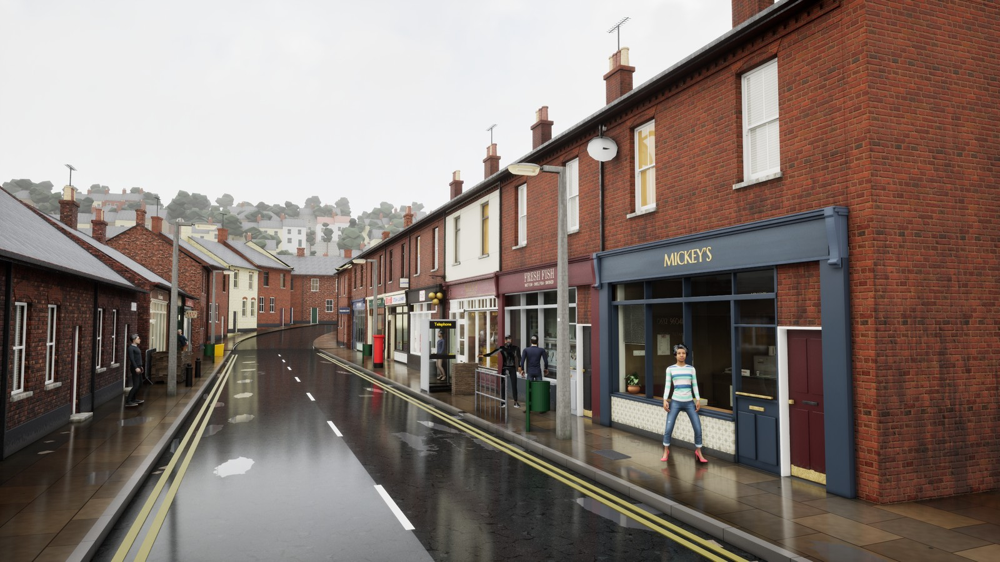
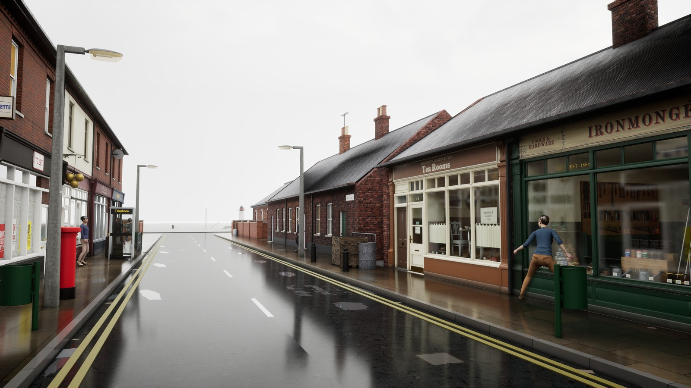
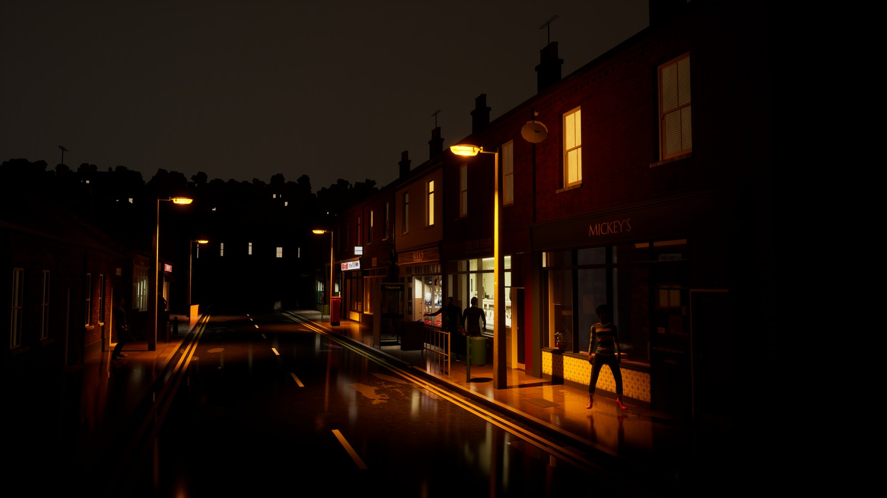
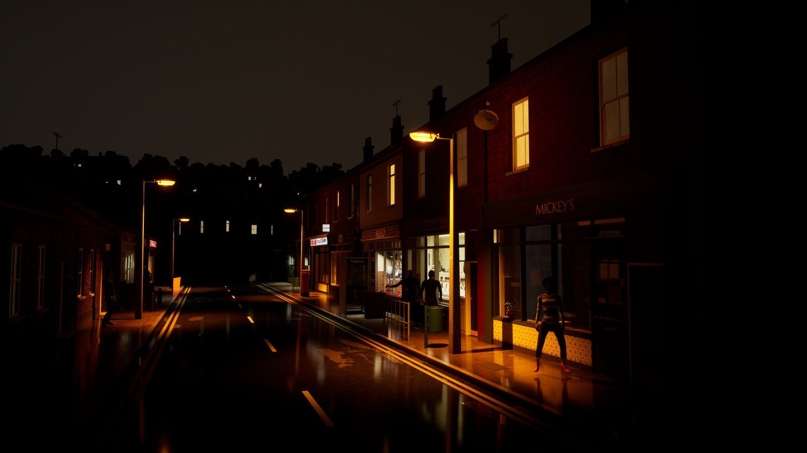
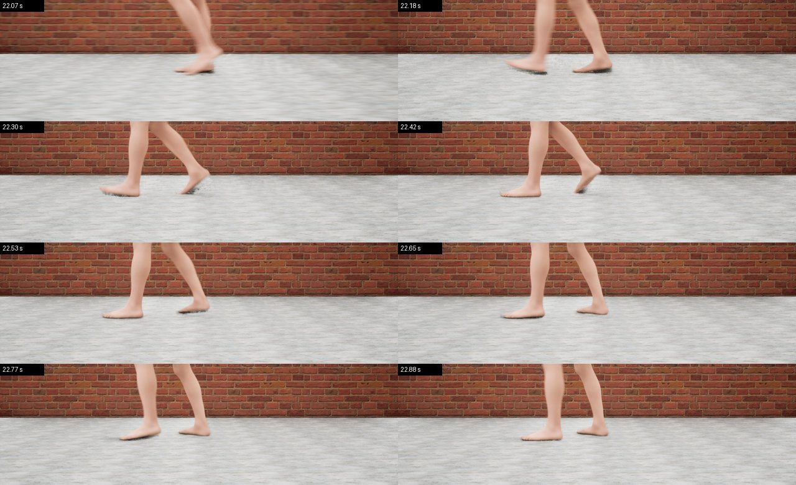

# For Jafar

The overview first; then the day's summary, under 200 words. Earlier summaries are in git and in
production/archive/FOR-JAFAR-to-2026-10-04.md (and FOR-JAFAR-to-2026-09-24.md before that).

## Overview (Sunday 25 October, evening: your week's order)

**Your order of 25 October evening, to Monday 2 November 13:00** (production/orders/2026-10-25.md, every item and study with a status; 26 October: carrying on through the 13:00 reset, as you said).
- **Phase 1 is open, not closed.** It failed its first exit check on 22 October. Fresh reviewers re-run that check once the walk, the clothes and speech pass; phase 2 waits for it, and the shops already in the street stay.
- **Recorded:** your rulings (RULINGS.md and DECISIONS.md); the study's order for both weeks at the top of the study plan; the order ledger, seeded with everything still open from before (21 and 23 October's leftovers, the cloud week's four questions, the three shops not yet in the street, FINDINGS' twenty faults, your two clicks on the old archive). A new check fails any push where an item has no status or vanishes without being done or dropped.
- **Done:** the health check (production/audits/health-2026-10-25.md); your progress page now has the studies bar and the 33 carried items.

**The studies (6 of 16 done: this week's six).**
- *Study 7, animation* (production/research/aaa-reference/studies/07-animation.md, passed its fresh review with fixes):
  - Neither game uses motion matching. Mafia walks on a layered state machine of single clips, Kingdom Come II on blend spaces. Both choose their starts, stops and turns rather than search for them: Kingdom Come II by distance, the stride's quarter and which leg.
  - Feet: Mafia traces the ground under each foot and locks a foot only in its duels; Kingdom Come II declares leg IK and a feet lock. The one perception figure found says viewers notice slides under about 2 cm, so our 3 cm bar is lenient.
  - For us: Epic's walk stays; its slides are in 134 of its 223 walking clips. If today's fixes fail by eye, stops and turns get chosen Kingdom Come II's way. Sitting can use the bench interaction already in Epic's sample. A first list of 14 street actions is drawn up, their sources still to check.
- *Study 6, characters and wardrobe* (studies/06-characters-wardrobe.md, passed its fresh review with fixes):
  - Both games dress people from a few shared bodies with skinned garments. Mafia: tops a median 22,000 triangles at full detail, trousers 9,600, four levels of detail. Kingdom Come II: one body per sex, 10 clothing layers.
  - Variety comes from material, not mesh: one layered material gives each garment 4 to 15 colourways, with grime and blood as values. Only hems, skirts and coat tails move; Mafia's crowd wears no cloth at all.
  - For us: Tom's jacket about 20,000 triangles, trousers about 9,000, 2048 textures, skinned, tails on a short bone chain. One base body per sex for the crowd. Mafia's own makers name Marvelous Designer.
- *Study 12, tech and budgets* (studies/12-tech-budgets.md, passed its fresh review with fixes):
  - Mafia runs the same lighting family as ours (software Lumen, virtual shadows, TSR); for 60 fps it lowers shadows, view, textures and reflections, keeps GI, and lets the picture size float between 40 and 83%.
  - Dense towns hold their frame by slowing what doesn't matter: Mafia freezes people unseen beyond 70 m and gives animation 3 ms; Kingdom Come II keeps 70 people in full detail within 150 m and budgets 8 shadow-casting lights a frame.
  - For us: those rules for phase 5's town; a shadow-light budget for the street's lamps; and our shop windows' reflections switch off below Mafia's reflection level 2, so a lower setting of ours needs a stand-in for glass.
- *Study 4, street and world building* (studies/04-street-world.md, passed its fresh review with fixes):
  - Mafia's dressed street: 14.7 m wide, 4.9 real props per 10 m (17 with ground dressing), all of it where the mission walks; its neighbours are nearly bare. Kingdom Come II's market street: 6 to 13 m wide, median 9.9.
  - Mafia builds streets from kit (433 meshes, each used about 78 times; one street, 2 house families) and keeps one-off buildings for its hero town; fake rooms behind windows are rare.
  - For us: Quay Street's 10.25 m is right. New checks for phase 2: at least 5 props per 10 m from a fixed list, kit reuse per street, every street view ending on a building.
- *Study 5, visuals* (studies/05-visuals.md, passed its fresh review with fixes):
  - Mafia's lamps are two lights each (a spot for the pool, a tiny bulb light), with light profiles and a little fog glow; its night is lit by contrast between lamp and dark, not by bright lamps.
  - Wet streets: one wetness value sets roughness 0.1 to 0.2, and puddles are decals; wear is mostly leak stains under sills and grime at wall bases.
  - For us: our shop glass stays as it is (our own research beats theirs here); windows get shaded frames first, fake rooms only higher up; lamps rebuilt Mafia's way.
- *Study 1, NPC life and AI* (studies/01-npc-life.md, passed its fresh review with fixes):
  - Kingdom Come II simulates its town: 1,354 people with homes, beds and working days; a crime becomes information a witness runs to a guard or a friend, kept 1 to 7 days. Mafia only stages people looping in place, and forgets.
  - LEDGER is already built the simulated way, with something both lack: who told whom, and talk that weakens as it travels.
  - For us: crime memory that lasts by kind (1 to 7 days); show a witness walking to tell someone; benches and beds as places in the routine; spreading only where people meet, as canon says.

**Your items (26 October, night).**
- *The walk (item 2), done:* your pass made it the default; the packaged game, walked by the AI tester, 14 of 15 stages (the one miss, Ron out of reach, is the route's old fault). The sit stays set aside.
- *Clothes (item 3):* Tom's zip jacket, made tonight by script from the Marvelous drape: an even game mesh of 21,448 triangles (budget 18,000 to 22,000), its maps baked (the metal zip and two hip pockets read), skinned to his skeleton and following him arms down, up, walking and sitting (pictures in production/previews, tom-zip-jacket-*). Next: onto Tom in the game (he is not yet a wearer in the garment system), then the gate. Its colour is yours to choose, with pictures from the game: navy until then.
- *Speech (item 4):* all three speak through Pocket (first sound about 0.2 s). The fast checker, three tries: the third, as you set it, holds your bar but clears only 3% of true sentences. Its 617 new test sentences showed Haiku's own check letting 18 to 23 invented first sentences through and refusing 31% of true ones. Rewriting only a refused sentence: 31 of 37 pass the real check; next, real turns. $6.21 of the $10 spent.
- *Mickey's office (item 5):* the small shadows at High fixed by raising one setting only while you are inside (about 0.2 ms a frame), passed in the editor beside plain High; packaged pictures after tonight's build. Faults behind the counter next.
- *Fallback, the simulation's port:* begun. Its blocker is gone: the 2.7 MB test table the port is checked against is now kept in pieces the upload guard accepts. Next: how well each person knows Tom's face, a rule that lives only in the game's code, given its home in the rules.

<!-- retention -->Disk (10-22 04:32): C: 79.9 GB free, F: 48.4 GB free; grew most since 10-21 12:17: C:\actions-runner-ledger\_work\ledger +1.5 GB, F:\LedgerTools\uv\cache +1.4 GB, F:\LedgerTools\bpyenv\Lib +0.9 GB.

<!-- morning pictures: written by tools/morning_pictures.py -->

**Morning, Tuesday 27 October. Phase 1, Prove the bottlenecks. On: 3. Tom's outfit: zip jacket baked, skinned; cuffs set aside, his word (BAKE-PLAN). Next: 4. Speech: all on Pocket; checker's third try clears 3% (invented-claims/); rewrite, early looks left off; two copies a check call next (voice-latency/CHECK-TIME).**

| | Today, 27 Oct | Yesterday, 26 Oct |
|---|---|---|
| The hook camera by day |  |  |
| The reverse view |  |  |
| The street at night |  |  |

The Hook sheet, the bar they are held to: 

No decision asked: these are for watching the street change.

<!-- /morning pictures -->

**Your week's order, where it stands (23 October, 14:55; the 22 October overview is in git).**
- *1 to 4.* Done 21 October: health check, branches home, your rules and combat doc, the editor connection.
- *5, the cloud's pieces.* Done: the lamp and every shop whose design passed, each through the game's gate (fresh reviewers, one per view). The launderette's, the fish market's, Mickey's and the empty unit's designs failed their own reviews, so they come next as new work:
  - Lamp post C stands at the four lamp spots, stained: run-off and lime from its arm, rust at its door plate, algae at its foot.
  - **Rita's front** (the shops' sample, which you kept): her night light and her wear passed every view.
  - **The ironmonger's** (no. 16): the shop passed all eight views, and its wear too.
  - **The newsagent's** (no. 18): the shop and its wear passed all ten views. Its box sign now lights after dark.
  - **The tea rooms** (no. 14): the shop passed all ten views after eight rounds of night fixes, and its wear too. Every bay of the west row now has its designed front.
  - **The grocer's** (no. 11, on the parade): the shop and its wear passed all ten views in ten rounds. Fixed on the way: its design's toy tomatoes (now real onions), a grey glass sign, a floating roll, a cut-off letter, its opening hours hanging in the air in front of its recessed door, and tins striped under the night light.
    - Set aside after two tries: a faint grey smoke on the glass above the jar lids by day (listed; next, a frame capture to find its cause).
  - New fronts no longer take the street's old grime, which had landed on the newsagent's pale paint with hard edges; they carry their own. One rule now, checked by the build: each worn front states it (Rita's and the ironmonger's keep the old grime, as passed).
  - **The chandler's** (no. 13, at the parade's end): the shop and its wear, all ten views in nine rounds. Fixed on the way: its door's foot was black glass at night (now a solid aluminium panel), its CLOSED card unreadable (now faintly lit), and the walls seen through its door at a slant were black (now lit as the room). Its sou'westers read as hard hats, then pith helmets, so they left the window.
    - Set aside after two tries: one side lining glares near white at night from one slant. The cause is found (the design keeps that lining out of the window lamp's light); the fix is next.
  - **The west row's three fronts** are cut under their low eave: the tan strip on the slates is gone, all 26 views passed (production/previews/west-row-eaves-2026-10-23.jpg).
  - Listed:
    - deep shadows under the tea rooms' table at night (two tries at a fill light failed; set aside);
    - a faint smoke on shop glass over dark goods by day (the grocer's jars, two smears on the ironmonger's glass), cause not found;
    - the street lamp's orange glare on the pale newsagent;
    - the chandler's side lining at night (above).
  - Pictures: production/previews/ironmonger-2026-10-22.jpg, newsagent-2026-10-22.jpg, tea-rooms-2026-10-23.jpg, grocer-2026-10-23.jpg, chandler-2026-10-23.jpg.
- *6, frame rate.* Done: the packaged walk's worst frame 30.3 ms (it was 63), P1 closed by a fresh review (production/research/pre-production/P1-PACKAGED-2026-10-21.md).
- *7, the walk and the clothes.* The walk was rebuilt on Epic's sample with motion matching and measured on a set route. Starts, stops and turns slide 13 to 67 cm (the bar is 3), so it is set aside and off by default. Your current walk fails too: it slides on about half its steps, the right foot on every stride (production/research/sit-and-turn/TOM-MOTION-MATCHING-2026-10-22.md). Clothes: Epic's Fab items all load in 5.8, but the Techwear Outfit is modern sportswear and the Construction Presets are bare bodies, not clothes; none can dress the Hook sheet's people. Your answers: the walk's next go by Epic's MetaHuman route, begun 24 October; Marvelous Designer one month, paid by you when Tom's outfit is ready.
- *8, speech.* Done. **The Gemini test:** on the reply check, Gemini 3.5 Flash-Lite took 0.60 s at the median against Haiku's 0.97, but it let 3 invented details in 42 through where Haiku lets 1 (you kept Haiku); Gemini 3.8 Flash was the most accurate but slower, 1.8 s (production/research/voice-latency/GEMINI-CHECK-2026-10-22.md). **Pocket no longer stalls the walk:** run at lower priority, the walk's slowest 1% is 20.6 ms (it was 34) and its worst 47 ms (it was 175). The one frame left over the bar is a separate stall that the usual card voice shows too (87 ms today), so the frame-rate margin is thinner than P1's close said (listed). **The real path with Pocket:** 20 checked replies, with the game open, first sound heard at 2.41 s at the median, the best yet (3.25 s before) but over 2 s. The model's first checked sentence alone now takes 2.10 s, so the voice is no longer the bottleneck (about $0.15 of your measuring dollar).
- *9, closing phase 1.* Done. Four fresh reviewers, one for each exit, found that none passes (production/audits/phase1-exit/CLOSE-2026-10-22.md): Tom is still the stand-in body and slides; nobody sits in the game as played; first speech is 3.25 s at best; the frame bar held once and failed its repeat, and card memory with the voice is 7 to 9.9 GB against 6; there is no wear in the office or on Rita's front. They also caught four of my own records wrong, all corrected on 22 October. You held phase 2 on your page: next week goes on these failed capabilities first.

**Your order of 23 October afternoon, frame headroom, to Saturday 14:00 (24 October, 07:25).** Both parts are done: frame headroom as far as it goes, then the launderette.
- *The launderette* (no. 9, east parade): all ten views passed in five rounds (production/audits/gate-launderette/GATE.md; picture production/previews/launderette-2026-10-24.jpg). Its design's three faults are fixed: the towels; the washing, now made by cloth simulation; and a real firm's name. Its front is worn, and it is dark at night with its sign lit. The gate also caught a flat side wall seen through the lobby's glass, now tiled like its room.
- *Card memory with the voice on the processor:* the game alone a median of 5.0 GB, peaks 5.9 GB walking, under the 6 GB line; with Pocket beside it, 5.2 GB in all (peaks 6.5). With the cast voice on the card the card in all peaks 7.4 to 8.7 GB (Needs you 2).
- *The 87 ms frame:* fixed. It was 13 of the engine's own screen passes built on first use; a bundled pipeline cache now compiles them before play, and no capture misses a pipeline. With the driver's cache cleared, as on a first launch, a player waits about 75 s at the title once.
- *The 38 ms frame with the voice:* partly. In half the walks the engine's first garbage collection, a minute after loading, cost one frame 31 to 50 ms; it is now collected behind the title, and walks with no voice hold every frame under 33.3 ms (worst 24 to 27). With Pocket working beside the game one frame still runs 42 to 55 ms at the day schedule's moment, when people move and shadows switch: the processor is crowded. Set aside after two tries; next, a trace of that moment.
- *The card's spare time:* at night back to 2.7 ms (it fell to 0.1 when today's shops came in: their window lamps' shadows); those lamps now cast only from their own shop and only within 15 m, which fresh reviewers passed on all four night street cameras. By day 1.7 to 1.8 ms against the plan's 2.5 (Needs you 3). The measure now sets the picture level (2.1 ms of the old "loss" was the Highest level).

**Your order of 24 October, the walk by Epic's MetaHuman route, to Saturday 18:00 (24 October, 11:49).** Built, measured, set aside on the bar after two tries, then judged by eye (production/research/sit-and-turn/METAHUMAN-ROUTE-2026-10-24.md, checked by two fresh reviewers).
- *How it works:* the sample's own character, unchanged and unseen, does the moving; Tom wears his MetaHuman (L1) over it through Epic's own retargeter, as the sample dresses its MetaHuman. Behind a switch, off by default; the packaged game builds and runs with the sample's parts in it (15 ms a frame, 5.5 GB on the card).
- *By eye:* ordinary steps hold their feet within 1.5 cm. But at about five moments a planted foot slides 10 to 15 cm: a stop where the front foot glides back flat about 13 cm (the one you might notice; picture below, the foot nearest the camera), a pivot, two turns from standing, a landing. The walk he has slides up to 50 cm.
- *Tried and failed (each shown to have taken):* the sample's own alternatives, and its foot lock held through each step.
- *Found on the way:* my height measure also counted swinging feet passing low as slides; a second reading from the animation's own marks passes (2.7 cm) but misses the real slides, so it is not taken. Nobody in the field publishes a pass mark; they judge by eye, so the worst steps are now judged in pictures.
- *Found since:* the slides are in the sample's own animation clips: Epic's foot lock holds each planted foot within half a centimetre, but some clips move a foot along the floor while marking it as lifting (the stop's glide is in Epic's own walk-stop clips: a flat foot travels 7 to 10 cm in the animation data itself). *Next go:* measure those clips, then choose between a stricter lock, leaving the sliding clips out, or a lock on Tom's own body.

**Your short job of 25 October.**
- *Disk:* Mafia: The Old Country is in C:/Games (49 GB), beside KCD2 (82 GB). C: has 209 GB free against its 40 floor, F: 31 against 20, so nothing was deleted.
- *The AAA study:* your plan is imported word for word (production/research/aaa-reference/STUDY-PLAN.md), and your amendment on Mafia's key is in the rulings and the legal file, with your word that you own both games.
  - *KCD2:* all 99 archives listed; its readable data unpacked to F: (31,150 files: tables, scripts, both regions' layers, English text). Schedules, crime and reputation each live in readable tables and scripts: Kuttenberg's schedule table alone holds 64,529 entries; there are 30 crimes, 308 crime behaviour trees and 203 reputation changes. Warhorse's official tools are not set up: they install only through a Steam account that owns the game, which I don't sign in to, and their licence covers individuals making mods only, "Companies are not entitled to use the Modding Tools" (Needs you 1). Their public wiki, which needs no account, documents where each system lives, and was read instead.
  - *Mafia:* **the published key was found** on a second search, in a public forum post of August 2025 (source in your study plan), and it opens the files. The first index now names all 139,791 packages and the sound files beside them: 45,898 map pieces, 22,781 animations, 19,396 environment pieces, 8,629 character assets, 595 AI assets. The game's 216 code modules are named too. The file viewer (FModel) runs on Microsoft's .NET 10 runtime on F: and, with the mappings file from TheNaeem's archive, opens every kind of package tried: data tables, animations and montages, a material instance, static and skeletal meshes, and an AI state tree. The file is from the game's December update and the installed game is newer, but it covers all the game's own gameplay classes.
  - *The coverage map:* 31 systems, each with where its logic lives in each game and which study covers it (production/research/aaa-reference/REFERENCE.md). Its open blind spots: Mafia's files are named but not yet read; how KCD2's code runs its tables; anything seen in play, until your recordings.

**The tester's walk (24 October, 02:30 to 03:01; production/playtest/nightly/2026-10-24.md).**
- The route ran 13 of 15 stages. It failed at Ron (never within reach, 3.7 m away) and at Darren (lost from sight).
- Nobody the record names saw Rita's window broken. One person, Rocco, showed afterwards that he knew, the same as the night before.
- Replies were first heard at 0.2 s. That is the stand-in's words with the real voice, not the real path.
- "That's all I know" was not measured.
- What broke the illusion:
  - townsfolk in the plain white base layer, two of them barefoot, one standing in the road;
  - people standing stiff in one pose, doing nothing;
  - Rita beside her smashed window, facing away, taking no notice.

**Risks, Monday's review (production/research/pre-production/6-RISKS.md).**
- R3, the street missing the bar: up, 25. The audit finds the visual method unproved: five proof-view steps were set aside, and Mickey's room failed three reviews. Phase 1's binding stop answers it.
- R1, empty or unchecked talk: level, 25. The bench's 23 to 25 empty answers have not been re-run; in play, 0 of 8 were empty (P4).
- R2, slow replies: level, 25. 7 October, the real path: first sound 4.6 s median. 21 October: on the processor the voice's own share is 0.13 s; the model's time is what remains (the Gemini test waits on your key).
- R10 and R7, the friends' evening: down, 9 and 10. It runs on your account with its $5 cap and no second account. The Shipping launch and the limits surviving a restart are proved in 0.6.
- R9, the way of working: level, 12. Orders now come weekly and there is one session, but that holds only if shown.

### Needs you

1. **Tonight's page, three taps** (https://claude.ai/artifact/GmtwhT5o89Ho9huHXYUieX): Darren's delivery A or B, blind; the checker's third try: keep Haiku alone and fix its leaks (recommended); price a north-east actor for Darren (recommended).
2. **Tom's jacket's cuffs, a third try?** Two fixes failed (they hang off his wrists). Research found the cause: the wrist's placement point sits mid-hand, so each cuff closes over the hand. Yes, by the researched route: placed at the arm's wrist end, then drawn in to grip (recommended); or no, the jacket waits.
3. **Leave Marvelous open with the bridge running** (recommended): Tom's jacket jobs run through it; if it is closed, one click on LEDGER bridge next time.
4. **Empty F:'s recycle bin** (recommended): it holds 7.2 GB of files you deleted yourself; F: is at its 20 GB floor, and tonight's build stopped on it once. I never empty it.

Your evening answers are recorded (shadows inside the office: yes; $10 for the slow-reply tests; the checker trained on Gemini's labels, no letter to Anthropic).

### Road to worth playing (PLAN.md)

- **0. Recover control** (0.20W): done 6 October, passed by a fresh review with narrow points.
- **1. Prove the bottlenecks** (1.00W): Mickey's front office (passed 8 October), then a complete Tom and one speaker, the voice under two seconds, and P1 packaged (closed 21 October). If a sample fails within its ceiling, I report the failed capability.
- **2. Quay Street from proved families** (2.00W): the brick, the facades, the wet street's seam and the hill return here.
- **3. Thirty minutes that hold** (0.75W): N3 ported, the weather proof, P4's gaps.
- **4. The friends' candidate** (0.50W): on your own account, $5 an evening.
- **5. The first town:** after the pilot.
- **Friends:** eight to twelve weeks, if phase 1 passes; low confidence.

## Builder, Monday 26 October (night)

**Failed:**
- The night's build: its request lost a race with my push (now retries); the second ask stopped on F:'s free space. Compressed my own files; asked again at 03:15.
- Tom's jacket's cuffs hang off his wrists; two fixes failed; researched (Needs you 2).
- Haiku's check, on 617 test sentences, lets 18 to 23 inventions through (Sheila denies the second book) and refuses 31% of true ones; its second look stays.
- The fast checker's third try holds your bar but clears only 3%.
- My first rewrite bench used only the check's first step; corrected.

**Done:**
- Tom's zip jacket: game mesh in budget, maps baked (zip, pockets, rib), skinned and posed; reviewed twice.
- Rewriting a refused sentence, in real turns: 8 of 10 rewritten, no fallbacks, 5-second waits not fewer; left off.
- The port: its test files under the upload limit; two rule sets moved home (face familiarity, who saw the window).
- The office's shadows at High: passed in the editor.

**Act on:** tonight's page, three taps; the cuffs (Needs you 2).
