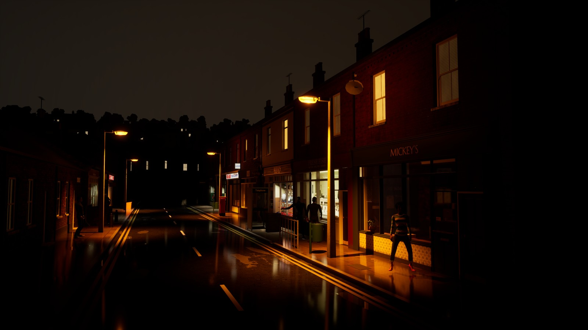
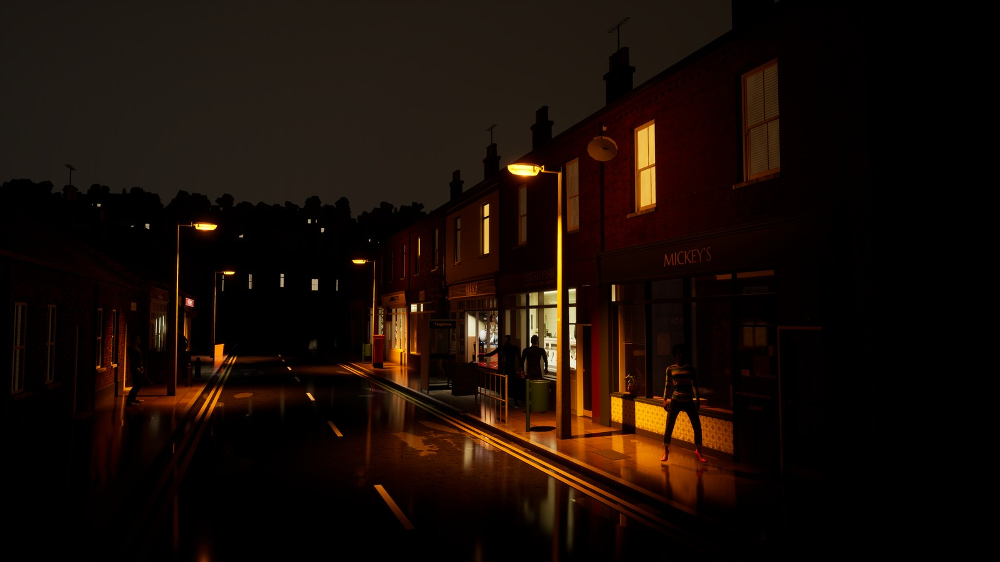

# For Jafar

The overview first; then the day's summary, under 200 words. Earlier summaries are in git and in
production/archive/FOR-JAFAR-to-2026-10-04.md (and FOR-JAFAR-to-2026-09-24.md before that).

## Overview (Saturday 24 October: your week's order, day four)

<!-- retention -->Disk (10-22 04:32): C: 79.9 GB free, F: 48.4 GB free; grew most since 10-21 12:17: C:\actions-runner-ledger\_work\ledger +1.5 GB, F:\LedgerTools\uv\cache +1.4 GB, F:\LedgerTools\bpyenv\Lib +0.9 GB.

<!-- morning pictures: written by tools/morning_pictures.py -->

**Morning, Saturday 24 October. Phase 2, Produce Quay Street from proved families. On: 2.1 Building kit re-seeded; upper rooms; near shop rooms: production/research/asset-plan/SUMMARY.md. Next: 2.2 Ground, wear, signage, furniture, vegetation, the hill.**

| | Today, 24 Oct | Yesterday, 23 Oct |
|---|---|---|
| The hook camera by day |  |  |
| The reverse view |  |  |
| The street at night |  |  |

The Hook sheet, the bar they are held to: 

No decision asked: these are for watching the street change.

<!-- /morning pictures -->

**Your week's order, where it stands (23 October, 14:55; the 22 October overview is in git).**
- *1 to 4.* Done 21 October: health check, branches home, your rules and combat doc, the editor connection.
- *5, the cloud's pieces.* Done: the lamp and every shop whose design passed, each through the game's gate (fresh reviewers, one per view). The launderette's, the fish market's, Mickey's and the empty unit's designs failed their own reviews, so they come next as new work:
  - Lamp post C stands at the four lamp spots, stained: run-off and lime from its arm, rust at its door plate, algae at its foot.
  - **Rita's front** (the shops' sample, which you kept): her night light and her wear passed every view.
  - **The ironmonger's** (no. 16): the shop passed all eight views, and its wear too.
  - **The newsagent's** (no. 18): the shop and its wear passed all ten views. Its box sign now lights after dark.
  - **The tea rooms** (no. 14): the shop passed all ten views after eight rounds of night fixes, and its wear too. Every bay of the west row now has its designed front.
  - **The grocer's** (no. 11, on the parade): the shop and its wear passed all ten views in ten rounds. Fixed on the way: its design's toy tomatoes (now real onions), a grey glass sign, a floating roll, a cut-off letter, its opening hours hanging in the air in front of its recessed door, and tins striped under the night light.
    - Set aside after two tries: a faint grey smoke on the glass above the jar lids by day (listed; next, a frame capture to find its cause).
  - New fronts no longer take the street's old grime, which had landed on the newsagent's pale paint with hard edges; they carry their own. One rule now, checked by the build: each worn front states it (Rita's and the ironmonger's keep the old grime, as passed).
  - **The chandler's** (no. 13, at the parade's end): the shop and its wear, all ten views in nine rounds. Fixed on the way: its door's foot was black glass at night (now a solid aluminium panel), its CLOSED card unreadable (now faintly lit), and the walls seen through its door at a slant were black (now lit as the room). Its sou'westers read as hard hats, then pith helmets, so they left the window.
    - Set aside after two tries: one side lining glares near white at night from one slant. The cause is found (the design keeps that lining out of the window lamp's light); the fix is next.
  - **The west row's three fronts** are cut under their low eave: the tan strip on the slates is gone, all 26 views passed (production/previews/west-row-eaves-2026-10-23.jpg).
  - Listed:
    - deep shadows under the tea rooms' table at night (two tries at a fill light failed; set aside);
    - a faint smoke on shop glass over dark goods by day (the grocer's jars, two smears on the ironmonger's glass), cause not found;
    - the street lamp's orange glare on the pale newsagent;
    - the chandler's side lining at night (above).
  - Pictures: production/previews/ironmonger-2026-10-22.jpg, newsagent-2026-10-22.jpg, tea-rooms-2026-10-23.jpg, grocer-2026-10-23.jpg, chandler-2026-10-23.jpg.
- *6, frame rate.* Done: the packaged walk's worst frame 30.3 ms (it was 63), P1 closed by a fresh review (production/research/pre-production/P1-PACKAGED-2026-10-21.md).
- *7, the walk and the clothes.* The walk was rebuilt on Epic's sample with motion matching and measured on a set route. Starts, stops and turns slide 13 to 67 cm (the bar is 3), so it is set aside and off by default. Your current walk fails too: it slides on about half its steps, the right foot on every stride (production/research/sit-and-turn/TOM-MOTION-MATCHING-2026-10-22.md). Clothes: Epic's Fab items all load in 5.8, but the Techwear Outfit is modern sportswear and the Construction Presets are bare bodies, not clothes; none can dress the Hook sheet's people. Your answers: the walk's next go is Epic's MetaHuman route after Monday; Marvelous Designer yes, its price now shown (Needs you 1).
- *8, speech.* Done. **The Gemini test:** on the reply check, Gemini 3.5 Flash-Lite took 0.60 s at the median against Haiku's 0.97, but it let 3 invented details in 42 through where Haiku lets 1 (you kept Haiku); Gemini 3.8 Flash was the most accurate but slower, 1.8 s (production/research/voice-latency/GEMINI-CHECK-2026-10-22.md). **Pocket no longer stalls the walk:** run at lower priority, the walk's slowest 1% is 20.6 ms (it was 34) and its worst 47 ms (it was 175). The one frame left over the bar is a separate stall that the usual card voice shows too (87 ms today), so the frame-rate margin is thinner than P1's close said (listed). **The real path with Pocket:** 20 checked replies, with the game open, first sound heard at 2.41 s at the median, the best yet (3.25 s before) but over 2 s. The model's first checked sentence alone now takes 2.10 s, so the voice is no longer the bottleneck (about $0.15 of your measuring dollar).
- *9, closing phase 1.* Done. Four fresh reviewers, one for each exit, found that none passes (production/audits/phase1-exit/CLOSE-2026-10-22.md): Tom is still the stand-in body and slides; nobody sits in the game as played; first speech is 3.25 s at best; the frame bar held once and failed its repeat, and card memory with the voice is 7 to 9.9 GB against 6; there is no wear in the office or on Rita's front. They also caught four of my own records wrong, all corrected on 22 October. You held phase 2 on your page: next week goes on these failed capabilities first.

**Your order of 23 October afternoon, frame headroom, to Saturday 14:00 (24 October, 07:25).** Both parts are done: frame headroom as far as it goes, then the launderette.
- *The launderette* (no. 9, east parade): all ten views passed in five rounds (production/audits/gate-launderette/GATE.md; picture production/previews/launderette-2026-10-24.jpg). Its design's three faults are fixed: the towels; the washing, now made by cloth simulation; and a real firm's name. Its front is worn, and it is dark at night with its sign lit. The gate also caught a flat side wall seen through the lobby's glass, now tiled like its room.
- *Card memory with the voice on the processor:* the game alone a median of 5.0 GB, peaks 5.9 GB walking, under the 6 GB line; with Pocket beside it, 5.2 GB in all (peaks 6.5). With the cast voice on the card the card in all peaks 7.4 to 8.7 GB (Needs you 2).
- *The 87 ms frame:* fixed. It was 13 of the engine's own screen passes built on first use; a bundled pipeline cache now compiles them before play, and no capture misses a pipeline. With the driver's cache cleared, as on a first launch, a player waits about 75 s at the title once.
- *The 38 ms frame with the voice:* partly. In half the walks the engine's first garbage collection, a minute after loading, cost one frame 31 to 50 ms; it is now collected behind the title, and walks with no voice hold every frame under 33.3 ms (worst 24 to 27). With Pocket working beside the game one frame still runs 42 to 55 ms at the day schedule's moment, when people move and shadows switch: the processor is crowded. Set aside after two tries; next, a trace of that moment.
- *The card's spare time:* at night back to 2.7 ms (it fell to 0.1 when today's shops came in: their window lamps' shadows); those lamps now cast only from their own shop and only within 15 m, which fresh reviewers passed on all four night street cameras. By day 1.7 to 1.8 ms against the plan's 2.5 (Needs you 3). The measure now sets the picture level (2.1 ms of the old "loss" was the Highest level).

**The tester's walk (24 October, 02:30 to 03:01; production/playtest/nightly/2026-10-24.md).**
- The route ran 13 of 15 stages. It failed at Ron (never within reach, 3.7 m away) and at Darren (lost from sight).
- Nobody the record names saw Rita's window broken. One person, Rocco, showed afterwards that he knew, the same as the night before.
- Replies were first heard at 0.2 s. That is the stand-in's words with the real voice, not the real path.
- "That's all I know" was not measured.
- What broke the illusion:
  - townsfolk in the plain white base layer, two of them barefoot, one standing in the road;
  - people standing stiff in one pose, doing nothing;
  - Rita beside her smashed window, facing away, taking no notice.

**Risks, Monday's review (production/research/pre-production/6-RISKS.md).**
- R3, the street missing the bar: up, 25. The audit finds the visual method unproved: five proof-view steps were set aside, and Mickey's room failed three reviews. Phase 1's binding stop answers it.
- R1, empty or unchecked talk: level, 25. The bench's 23 to 25 empty answers have not been re-run; in play, 0 of 8 were empty (P4).
- R2, slow replies: level, 25. 7 October, the real path: first sound 4.6 s median. 21 October: on the processor the voice's own share is 0.13 s; the model's time is what remains (the Gemini test waits on your key).
- R10 and R7, the friends' evening: down, 9 and 10. It runs on your account with its $5 cap and no second account. The Shipping launch and the limits surviving a restart are proved in 0.6.
- R9, the way of working: level, 12. Orders now come weekly and there is one session, but that holds only if shown.

### Needs you

1. Marvelous Designer, your yes of Thursday and Friday: its price is 39 USD a month or 280 a year, with a two-week free trial for new users (read on its own site this morning; production/research/clothing-pipeline/MARVELOUS-PRICE-2026-10-23.md). Recommended: start with the free trial for Tom's one outfit, signed up by you (I cannot make accounts or pay); its licence for game use is read before anything made in it goes in.

2. The game's voice: the packaged game starts the cast voice on the card (the card in all then peaks 7.4 to 8.7 GB). The cast voice on the processor is too slow on this PC (1.56 times slower than speech, and a 197 ms frame). Pocket on the processor keeps up (2.6 times faster than speech) and fits the card, but was set aside in September for losing the cast's likeness. Recommended: keep the cast voice on the card for now and set the 6 GB line as the game alone (5.9 GB peak), since the card has 10 GB (Windows gives the game 9.4).

3. The card's spare time by day is 1.7 to 1.8 ms against the plan's 2.5, since today's two shops; frames hold (worst 24 to 27 ms standing). Winning it back means trimming the sun's shadows, which changes the look. Recommended: accept 1.7 ms by day for now and revisit with phase 2's street budget.

Your answers are recorded: the walk's next go by Epic's MetaHuman route after Monday, and the reply check stays on Haiku.

### Road to worth playing (PLAN.md)

- **0. Recover control** (0.20W): done 6 October, passed by a fresh review with narrow points.
- **1. Prove the bottlenecks** (1.00W): Mickey's front office (passed 8 October), then a complete Tom and one speaker, the voice under two seconds, and P1 packaged (closed 21 October). If a sample fails within its ceiling, I report the failed capability.
- **2. Quay Street from proved families** (2.00W): the brick, the facades, the wet street's seam and the hill return here.
- **3. Thirty minutes that hold** (0.75W): N3 ported, the weather proof, P4's gaps.
- **4. The friends' candidate** (0.50W): on your own account, $5 an evening.
- **5. The first town:** after the pilot.
- **Friends:** eight to twelve weeks, if phase 1 passes; low confidence.

## Builder, Saturday 24 October (07:25)

**Failed:**
- **A frame with the voice beside the game:** one per walk still runs 42 to 55 ms when the day's schedule moves people and shadows switch; set aside after two tries.
- **The card's spare time by day:** 1.7 to 1.8 ms against the plan's 2.5, since the grocer and the chandler came in (Needs you 3).
- **Set aside:** the chandler's side lining glares at night; its sou'westers left the window.

**Done:**
- **The chandler's** passed its ten views: item 5 is done.
- **The 87 ms stall** is gone: a bundled pipeline cache.
- **The night's spare card time** is 2.7 ms: window lamps cast shadows only near their own shop.
- **Card memory:** the game alone peaks 5.9 GB.
- **The launderette** passed all ten views with its wear: your 23 October order is done.

**Stopped** at 07:30 until Monday 14:00, as you ordered; nothing is left running but the nightly jobs.

**Act on:** Needs you 2 and 3, the voice and the daytime budget; the Marvelous trial is yours to start.
