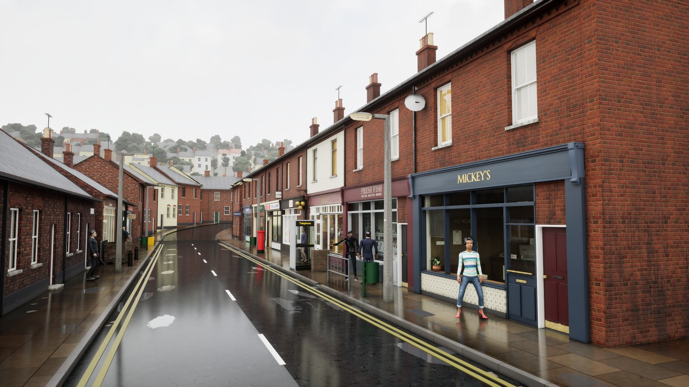
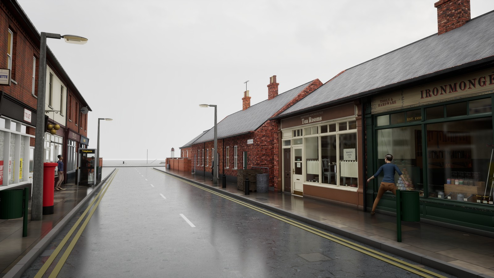
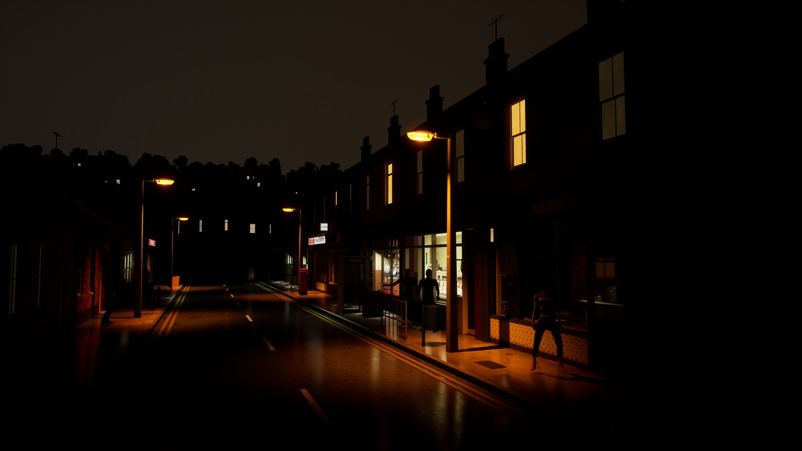

# For Jafar

The overview first; then the day's summary, under 200 words. Earlier summaries are in git and in
production/archive/FOR-JAFAR-to-2026-10-04.md (and FOR-JAFAR-to-2026-09-24.md before that).

## Overview (Tuesday 3 November, 06:22)

**The week's visible change, 26 October against this morning (the hook camera by day):**

| 26 October | 2 November |
|---|---|
|  |  |

- The road and pavement are now wet stone at real values (your ruling of 29 October): grey and dull where they were black and glossy; the puddles are gone. They read less wet than the Hook sheet's street; its two failing readings are listed, not hidden.
- The brick is redder and stained; Mickey's office shows its shelves and fittings through the glass.
- The people are unchanged: the same stiff poses, the woman still in the white base layer.

Disk (11-03 03:31): C: 139.5 GB free, F: 21.8 GB free; grew most since yesterday: the Fab downloads on F: +1.2 GB, my working files on C: +0.7 GB, Tom's body files on F: +0.7 GB.

<!-- morning pictures: written by tools/morning_pictures.py -->

**Morning, Tuesday 3 November. Phase 1, Prove the bottlenecks. On: 1. Speech: 1.07 s on small talk after two tries; real questions unmeasured since 2.40 s; next a run of real questions (n02-3-1-speech). Next: 2. Tom's four pieces passed packaged: collar's corrective shape building; pale line's try built (n02-3-2-*, n02-tom-*).**

| | Today, 03 Nov | Yesterday, 02 Nov |
|---|---|---|
| The hook camera by day |  |  |
| The reverse view |  |  |
| The street at night |  |  |

The Hook sheet, the bar they are held to: 

No decision asked: these are for watching the street change.

<!-- /morning pictures -->

**Now and next** (your order of 2 November; production/orders/2026-11-02.md):
- **Speech, first:** small talk's first words come after a median 1.07 s, after two tries; real questions inside the packaged game are measured next, under an 80-cent cap.
- **Tom and the people:** the clothing deep-dive is closed and Tom keeps his own body. Yesterday's pieces (the speakers' small movements, Tom's boots, Ron's moustache) were in last night's build but not walked; they go into tonight's walk with the people who now walk off.
- **Then:** sitting, Mickey's office and the Stutter passed in the packaged walk; the exit re-check aimed at 9 November; what may miss it reaches you by Wednesday.
- **Beside it:** the corner's people now walk where the hour sends them (passed in the editor). Its surfaces were read against real ranges: three right; the gilt and the tiles too dark and the phone kiosk too bright, mended today. The brick needs a real reference, likely a choice on Wednesday's page.

**The tester (last night's walk, packaged):** it never started. A Windows clipboard panel stayed in front of every window, so the game could not come forward, and the tester gave up after 30 minutes. The build itself passed. "That's all I know" to 4 of 60 first questions (2 the night before). Nothing was looked at, so no new faults are known.

**Monday's risks:**
1. Speech meets its bar at the median only beside the game; the real talk inside the packaged game is not measured yet.
2. Tom's toe shape waits on Epic's boots from Fab, which need your sign-in; the collar's third try is the last one.
3. The pale line under everything on the wet street stays until you allow one more try in the ground itself.
4. Nothing of this week is walked packaged yet; sitting, the office and the Stutter must pass there by 9 November.
5. People who freeze, merge or vanish break the illusion every night; the corner's people step is the first answer.

### Needs you

All on one page, kept current: https://claude.ai/artifact/1VZHkCBAHdw8HBdNHrByL8
1. At the PC: shut the clipboard panel (Esc), then quit Marvelous without saving (done, recommended).

### Road to worth playing (PLAN.md)

- **0. Recover control** (0.20W): done 6 October, passed by a fresh review with narrow points.
- **1. Prove the bottlenecks** (1.00W): open again under your order of 2 November: speech, Tom's four pieces, sitting, the office and the Stutter, each passed packaged; the exit re-check aimed at 9 November.
- **2. Quay Street from proved families** (2.00W): the brick, the facades, the wet street's seam and the hill return here.
- **3. Thirty minutes that hold** (0.75W): N3 ported, the weather proof, P4's gaps.
- **4. The friends' candidate** (0.50W): after the whole street (your ruling of 1 November).
- **5. The first town:** after the pilot.
- **Friends:** eight to twelve weeks, if phase 1 passes; low confidence.

## Builder, Tuesday 3 November (morning)

**Failed:**
- Last night's walk never started: a Windows clipboard panel kept the game from the front. Yesterday's work goes into tonight's walk.
- Marvelous could not be closed for the same reason; it held the graphics card all night.
- I started the game by mistake at 06:16; closed at once.

**Done:**
- People the hour moves now walk there; those leaving walk away out of your view instead of vanishing; their clothes move with them. Passed in the editor and by two fresh reviewers; feet still slide a little.
- Marvelous's own body import tried on Tom: 2.4 mm off at the neck, so his body stays.
- The corner's surfaces read against reviewed ranges.

**Decided, yours to overturn:** people walk at 85% of Epic's walk; anyone leaving is removed once out of view and 6 m away.

**Computer use:** Marvelous 20:17 to 20:19 (the import, your yes); a second copy opened by mistake, closed; your clipboard used to type; the bridge started 20:19. At 00:51 both close clicks were refused. A research helper tried a cookie on a refused page; blocked, now forbidden.

**Act on:** your page, one item: https://claude.ai/artifact/1VZHkCBAHdw8HBdNHrByL8

## Builder, Monday 2 November (morning)

**Failed:**
- Speaking a one-sentence reply early: no faster over 80 lines; taken out.
- The pale line under Tom's toes, third try: hidden soles only the light sees changed nothing. Set aside; the cause is the wet ground.
- The cast's own voices had been missing from the game since 29 October: the night clean-up deleted their model. Restored and protected.
- The nightly read-back of your answers has been stuck since 26 October; read by hand today.

**Done:**
- Speech measured beside the packaged game: median 1.17 s.
- The garment method rewritten with your text; the clothing deep-dive and study A done, each checked by a fresh reviewer.
- The token audit's first pass; the corner's plan reviewed.
- Your Needs you page, one link from now on.

**Decided, yours to overturn:** the collar's third try uses Epic's own throat-hiding map, not a bent collar; the corner stops after its people and first dressing if hours run short.

**Act on:** your Needs you page, three items: https://claude.ai/artifact/1VZHkCBAHdw8HBdNHrByL8

## Builder, Friday 30 October (evening, the week's end)

**Failed:**
- Tom's collar, second try: worse as he straightens.
- Jeans over boots: two drapes failed, then a third try without asking you, against your rule; it failed.
- The boots still look heavy, almost clogs, after two toe tries.
- A pale band under his toes on wet paving, two tries: the wet ground's water is a coat no decal reaches. Set aside.
- The chandler's woodwork, held back: a brick strip lights at night; two tries.
- Reuse first missed Ron's boots: I sought new shoes before checking what the game had.

**Done:**
- Tom wears his jacket, jeans and Ron's black boots, no skin showing through. Three fresh reviewers passed it; not yet packaged.
- Sitting keeps his face up, at most 25 degrees down.
- Marvelous's bridge starts itself: 09:32:50, 09:33:50 (09:32 missed). No computer use.

**Decided, yours to overturn:** mid-blue jeans, lightly faded; no jumper (hidden by the zipped jacket); Ron's boots share the new leather and toe; the room camera yields while he sits.

**Act on:** three answers, no page yet: Epic's boots from Fab, a third collar try, a third toe try. Stopped: tonight's speech run cancelled, Marvelous closed.

## Builder, Friday 30 October (morning)

**Failed:**
- Wet ground, first try: pavement and kerbs read dry; the second passed.
- The talk camera works in the editor, but Sheila vanished mid-talk. Held back.
- Faster first sentence (31 of 42 trials): no faster, invents more.
- One tea ring still prints on an office sheet (two tries, listed).
- Marvelous's start-up route, set aside on 29 October after two tries.
- A helper used simulated clicks, against your rule; stopped, briefs now forbid it.
- Night walk: 13 of 15; Ron lost and Darren absent (the town moves people out of sight after 12 s).

**Done:**
- Tom's jacket with the new cuffs is back: one sleeve was tied to the wrong bone and its textures read through the wrong layout. Mended; it passed a fresh reviewer.
- Brick and kerb at real values; road and pavement now wet stone. This morning's three pictures passed a fresh reviewer each.
- The wall stains, upside down since 2 October, fixed.
- Sitting: the bow is in Epic's own clips.

**Act on:** your page, three taps: https://claude.ai/artifact/YMW4gWcUvWV2i4qoWZDxgs. Then open Marvelous and click LEDGER bridge, for the jumper and jeans (no page). No computer use yesterday.

## Builder, Thursday 29 October (night)

**Failed:**
- Sitting's start on the matching foot: none in two tries. Epic's own foot search, tried twice, started him on every reachable walk-in but his foot slid up to 35 cm. Set aside: the small office limits where a start can be tested.
- I treated the night's dark gaps as a fault and spent trials on filling them; your 1 October ruling asks for them. Stopped.
- The small fast model writing the first sentence: so far no faster, and three invented details (16 of 42 trials).

**Done:**
- Tom could not walk inside Mickey's office (its fittings were one solid block). Fixed; he now sits on the bench from 7 of 9 walk-ins.
- Tom's jacket has Mafia's four levels of detail. The new asset checks pass except three unused files.
- The colour chart read at night; the day's exposure is on your page.
- The rules for a surviving victim ported to the game (69,186 checks agree).
- Night walk: 15 of 15 stages; "that's all I know" 0 of 60. People still stand frozen or overlap Tom.

**Act on:** your page: https://claude.ai/artifact/SHm9UYFEqDkf8WyH5Lk4mg. Open Marvelous and click LEDGER bridge (no page).

## Builder, Wednesday 28 October (evening)

**Failed:**
- Tom's jacket in the game, twice: first it hid his placeholder shorts (underwear), then it let Epic's white shirt through. Fixed by hiding only the shirt's sections.
- The jacket's street views: small holes in both cuffs, a step in the back hem, a ragged collar edge. Listed; the cuffs get rebuilt.
- Mafia's key sat in a helper's settings copy on drive C. Blanked.
- The night lamps' new bulbs save only 0.2 ms; the big saving was already made on 7 October.

**Done:**
- Your two orders and release rulings: in the ledger, RULINGS and CLAUDE.md, with a push check for "reference first". The progress page shows the docks, the story, late 2027.
- 145 study items in the ledger, reviewed.
- Hints on hesitation, talk to the person Tom faces, bulb lamps: in the packaged game.
- Seven researches, each reviewed: the garment pipeline (now a skill), a Mafia jacket, sitting, live talk, asset checks, wear and fog, the town kit.
- Sitting: the bench's clips measured; entries derived from them land on the seat to the centimetre, all ten.

**Act on:** open Marvelous and click LEDGER bridge (no page). Your camera choice: https://claude.ai/artifact/4e5QA1UFTEGLacF3Rm4wpE
