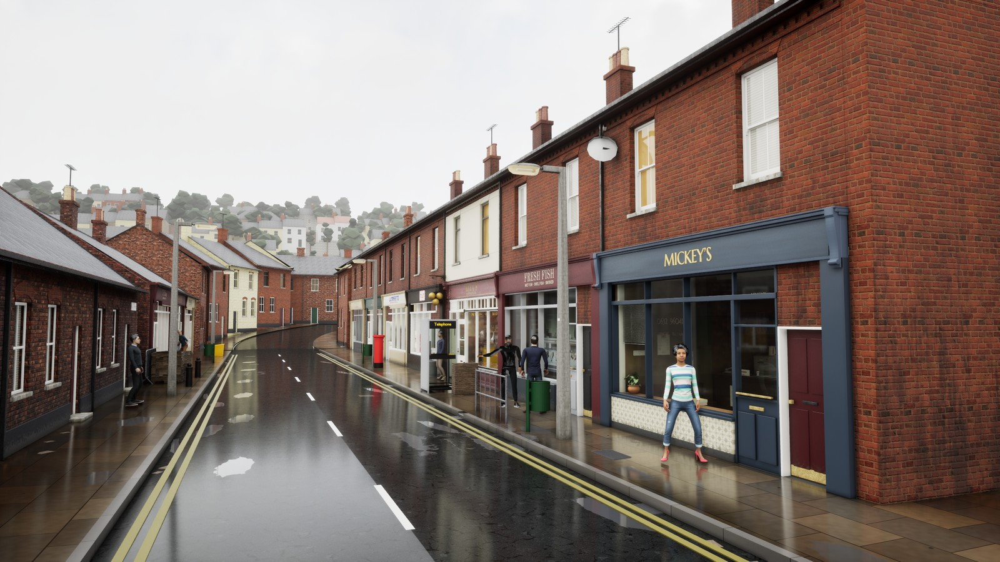
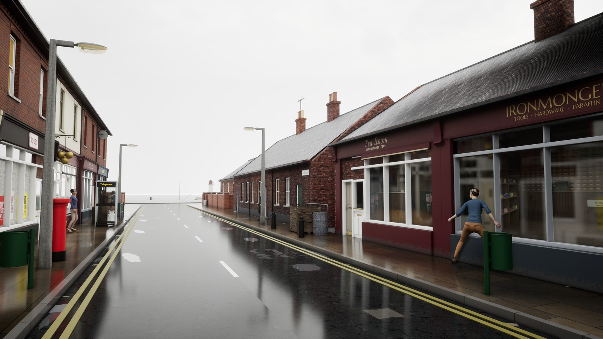
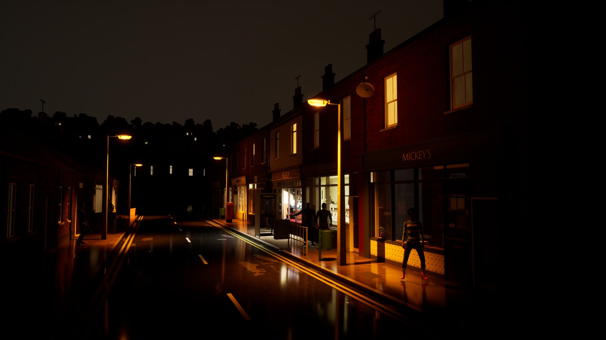

# For Jafar

The overview first; then the day's summary, under 200 words. Earlier summaries are in git and in
production/archive/FOR-JAFAR-to-2026-10-04.md (and FOR-JAFAR-to-2026-09-24.md before that).

## Overview (Thursday 22 October: your week's order, day two)

<!-- morning pictures: written by tools/morning_pictures.py -->

**Morning, Thursday 22 October. Phase 1, prove the bottlenecks. On: 1.1 Mickey's front office: production/research/pre-production/3-PROOFS.md. Next: 1.2 Tom and a speaker: production/casting/CASTING.md.**

| | Today, 22 Oct | Yesterday, 21 Oct |
|---|---|---|
| The hook camera by day |  |  |
| The reverse view |  |  |
| The street at night |  |  |

The Hook sheet, the bar they are held to: 

No decision asked: these are for watching the street change.

<!-- /morning pictures -->

**Your week's order, where it stands (22 October, 17:20; the 21 October overview is in git).**
- *1 to 4.* Done 21 October: health check, branches home, your rules and combat doc, the editor connection.
- *5, the cloud's pieces.* Lamp post C stands at the four lamp spots, darker, and since 22 October stained: run-off and lime from its arm, rust under its door plate, algae at its foot (all six views passed; production/previews/lamp-staining-2026-10-22.jpg). Rita's front, display and room are in the street as the shops' sample: four day views passed fresh reviewers, and her night light passed on 22 October (below). You answered on 22 October: keep her front and bring the other shops the same way; your message put the lamp's staining and the next shop family next whenever 7 or 8 was blocked.
- *5, today (22 October, after 7 to 9):* Rita's night light rebuilt to the cloud's own design (strip lights under the shelves, a dimmer head lamp), its strength measured. All five night views passed fresh reviewers: her glass no longer burns (6% to 0% from the hook camera), the red no longer stains the pale goods, and her window now sits just below the fish shop's. On the way, night pictures were found to be taken before the light settled; tomorrow's morning night picture will look darker for that reason, not because the street changed. Her front's wear: the first try, in the street's own material, failed (frost on the cream, her red shifted); the second, painted into her front's own textures, passed all eight views in the evening (grime at the foot, chipped rails and sill, dirt in the corners; her paint above unchanged).
- *6, frame rate.* Done: the packaged walk's worst frame 30.3 ms (it was 63), P1 closed by a fresh review (production/research/pre-production/P1-PACKAGED-2026-10-21.md).
- *7, the walk and the clothes.* The walk was rebuilt on Epic's sample with motion matching and measured on a set route. Starts, stops and turns slide 13 to 67 cm (the bar is 3), so it is set aside and off by default. Your current walk fails too: it slides on about half its steps, the right foot on every stride (production/research/sit-and-turn/TOM-MOTION-MATCHING-2026-10-22.md). Clothes: Epic's Fab items all load in 5.8, but the Techwear Outfit is modern sportswear and the Construction Presets are bare bodies, not clothes; none can dress the Hook sheet's people (Needs you 1).
- *8, speech.* Done. **The Gemini test:** on the reply check, Gemini 3.5 Flash-Lite took 0.60 s at the median against Haiku's 0.97, but it let 3 invented details in 42 through where Haiku lets 1 (Needs you 2); Gemini 3.8 Flash was the most accurate but slower, 1.8 s (production/research/voice-latency/GEMINI-CHECK-2026-10-22.md). **Pocket no longer stalls the walk:** run at lower priority, the walk's slowest 1% is 20.6 ms (it was 34) and its worst 47 ms (it was 175). The one frame left over the bar is a separate stall that the usual card voice shows too (87 ms today), so the frame-rate margin is thinner than P1's close said (listed). **The real path with Pocket:** 20 checked replies, with the game open, first sound heard at 2.41 s at the median, the best yet (3.25 s before) but over 2 s. The model's first checked sentence alone now takes 2.10 s, so the voice is no longer the bottleneck (about $0.15 of your measuring dollar).
- *9, closing phase 1.* Done. Four fresh reviewers, one for each exit, found that none passes (production/audits/phase1-exit/CLOSE-2026-10-22.md): Tom is still the stand-in body and slides; nobody sits in the game as played; first speech is 3.25 s at best; the frame bar held once and failed its repeat, and card memory with the voice is 7 to 9.9 GB against 6; there is no wear in the office or on Rita's front. They also caught four of my own records wrong, all corrected today. The plan's stop rule halts expansion until you decide (Needs you 1).

**Risks, Monday's review (production/research/pre-production/6-RISKS.md).**
- R3, the street missing the bar: up, 25. The audit finds the visual method unproved: five proof-view steps were set aside, and Mickey's room failed three reviews. Phase 1's binding stop answers it.
- R1, empty or unchecked talk: level, 25. The bench's 23 to 25 empty answers have not been re-run; in play, 0 of 8 were empty (P4).
- R2, slow replies: level, 25. 7 October, the real path: first sound 4.6 s median. 21 October: on the processor the voice's own share is 0.13 s; the model's time is what remains (the Gemini test waits on your key).
- R10 and R7, the friends' evening: down, 9 and 10. It runs on your account with its $5 cap and no second account. The Shipping launch and the limits surviving a restart are proved in 0.6.
- R9, the way of working: level, 12. Orders now come weekly and there is one session, but that holds only if shown.

### Needs you

Your page today (https://claude.ai/artifact/2yznAYjEwDVv3RvzzKUpBR) asks all three, one tap each:
1. Phase 2: start it? Recommended: not yet; next week goes on the failed capabilities first.
2. Clothes: try Marvelous Designer? Recommended: yes, one month for one sample outfit (Tom's), with the price shown to you before anything is bought.
3. The reply check on Gemini 3.5 Flash-Lite (about 0.4 s faster, but 3 invented details in 42 against Haiku's 1): switch? Recommended: no, not yet.

For tomorrow's page:
4. Tom's walk: Epic's sample already ships the way to put its walk on a MetaHuman (its own character, Tom's body worn over it). Try that after Monday, as the walk's next go? Recommended: yes; the first go is set aside under your two-tries rule.

### Road to worth playing (PLAN.md)

- **0. Recover control** (0.20W): done 6 October, passed by a fresh review with narrow points.
- **1. Prove the bottlenecks** (1.00W): Mickey's front office (passed 8 October), then a complete Tom and one speaker, the voice under two seconds, and P1 packaged (closed 21 October). If a sample fails within its ceiling, I report the failed capability.
- **2. Quay Street from proved families** (2.00W): the brick, the facades, the wet street's seam and the hill return here.
- **3. Thirty minutes that hold** (0.75W): N3 ported, the weather proof, P4's gaps.
- **4. The friends' candidate** (0.50W): on your own account, $5 an evening.
- **5. The first town:** after the pilot.
- **Friends:** eight to twelve weeks, if phase 1 passes; low confidence.

## Builder, Friday 23 October (written Thursday 19:25, for your morning)

**Failed:**
- **Phase 1 closed with no exit passing** (four fresh reviews): Tom and the walk, period clothes, first speech within 2 s, the frame budget's headroom, the office's wear.
- **Tom's motion-matched walk** slides 13 to 67 cm at starts, stops and turns. Your current walk fails too, on about half its steps.
- **Epic's garments** cannot dress 1990 people.
- **Rita's front wear, first try:** it read as frost on the pale paints.

**Done:**
- **Gemini 3.5 Flash-Lite** checks in 0.60 s against Haiku's 0.97, but lets 3 invented details in 42 through.
- **Pocket TTS** no longer stalls the walk. First speech on the real path is 2.41 s, the best yet; the model is now the slow part.
- **Rita's night light** passed all five night views, and was checked in the packaged game.
- **Rita's front wear, second try,** passed all eight views (production/previews/rita-front-wear-2026-10-22.jpg).
- **The lamp's staining** passed all six views: run-off from the arm, rust, algae.

**Act on:** your page, three taps, at the link above.
