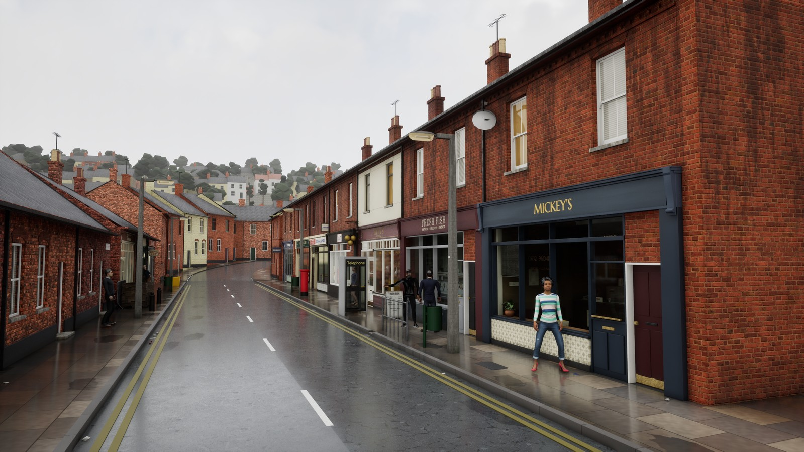
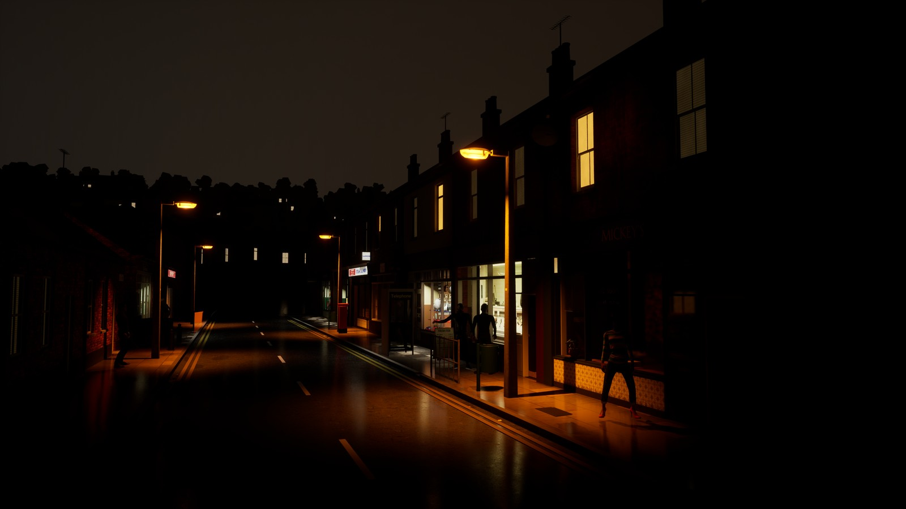

# For Jafar

The overview first; then the day's summary, under 200 words. Earlier summaries are in git and in
production/archive/FOR-JAFAR-to-2026-10-04.md (and FOR-JAFAR-to-2026-09-24.md before that).

## Overview (Wednesday 4 November, 06:20)

**Tokens, Tuesday 3 November:** history 53% of the spend, Opus 98%, reviewing 27% (3,538 steps, US$351.80 at list prices; Monday 45%, 98%, 22%).

Disk (11-04 03:31): C: 134.5 GB free, F: 28.3 GB free; grew most since yesterday: the build cache on C: +8.9 GB, gate pictures on F: +0.5 GB, my working files on F: +0.5 GB.

<!-- morning pictures: written by tools/morning_pictures.py -->

**Morning, Thursday 5 November. Phase 1, Prove the bottlenecks. On: 2. Tom's four pieces passed packaged: jeans and boots passed (4 Nov); jacket (collar) and jumper to go (n02-3-2-*, n02-tom-*). Next: 3. Office passed packaged (4 Nov); sitting, the Stutter to go (n02-3-3-*).**

| | Today, 05 Nov | Yesterday, 04 Nov |
|---|---|---|
| The hook camera by day |  |  |
| The reverse view |  |  |
| The street at night |  |  |

The Hook sheet, the bar they are held to: 

No decision asked: these are for watching the street change.

<!-- /morning pictures -->

**Now and next** (your order of 2 November; production/orders/2026-11-02.md):
- **Speech, first:** small talk's first words come after a median 1.07 s, after two tries; real questions inside the packaged game are measured next, under an 80-cent cap.
- **Tom and the people:** the clothing deep-dive is closed and Tom keeps his own body. Yesterday's pieces (the speakers' small movements, Tom's boots, Ron's moustache) were in last night's build but not walked; they go into tonight's walk with the people who now walk off.
- **Then:** sitting, Mickey's office and the Stutter passed in the packaged walk; the exit re-check aimed at 9 November; what may miss it reaches you by Wednesday.
- **Beside it:** the corner's people now walk where the hour sends them (passed in the editor). Its surfaces were read against real ranges: three right; the gilt and the tiles too dark and the phone kiosk too bright, mended today. The brick needs a real reference, likely a choice on Wednesday's page.

**The tester (last night's walk, packaged, Tuesday evening's build):** it ran this time. 14 of 15 stages; it lost sight of Darren after the window. One witness (Rocco) showed he knew, one more than the night before. "That's all I know" to 3 of 60 first questions (4 before). What broke the illusion: Ron and the woman by Mickey's still in the white base layer; Ron heard speaking while out of sight; the road ending in a grey slab and blank sky past the houses. The new brick, the A-board, crates, kiosk and the reaction at Rita's window are judged from its pictures today.

### Needs you

All on one page, kept current: https://claude.ai/artifact/1VZHkCBAHdw8HBdNHrByL8
1. In the app: set the task "LEDGER: fresh session at a handover" to Auto, as you did the daily one (done, recommended).

### Road to worth playing (PLAN.md)

- **0. Recover control** (0.20W): done 6 October, passed by a fresh review with narrow points.
- **1. Prove the bottlenecks** (1.00W): open again under your order of 2 November: speech, Tom's four pieces, sitting, the office and the Stutter, each passed packaged; the exit re-check aimed at 9 November.
- **2. Quay Street from proved families** (2.00W): the brick, the facades, the wet street's seam and the hill return here.
- **3. Thirty minutes that hold** (0.75W): N3 ported, the weather proof, P4's gaps.
- **4. The friends' candidate** (0.50W): after the whole street (your ruling of 1 November).
- **5. The first town:** after the pilot.
- **Friends:** eight to twelve weeks, if phase 1 passes; low confidence.

## Builder, Wednesday 4 November (morning)

**Failed:**
- The night walk lost Darren after the window (14 of 15 stages); the people's white base layer and the bare road's end still break the illusion.
- The morning session waited 50 minutes to start: two older Builder sessions kept showing activity while doing nothing. Started 06:09.

**Done:**
- Last night's walk ran in full this time, on Tuesday evening's build, with the brick the game had been missing since 4 October.
- The morning pictures were taken on time by the night job.

**Today:** speech's run of twenty real questions in the packaged game; what may miss the 9 November exit, told to you today; the corner's midweek page.

**Act on:** one item on your page: https://claude.ai/artifact/1VZHkCBAHdw8HBdNHrByL8

## Builder, Tuesday 3 November (evening)

**Failed:**
- Speech's run of real questions could not settle the bar (two questions asked five times each). Run F, twenty different questions, runs on tonight's build.
- Tom's crown, the fourth try (your yes): still pale; a known fault now.
- Found: since 4 October the game you play showed a plainer brick than every editor picture. Fixed tonight, with a check.

**Done:**
- Your rulings file cleaned; tonight's three efficiency rulings set up (helpers' models, a fresh session each morning, reviews sized to the piece).
- The corner: A-board, milk crates, kiosk, litter, a reaction at Rita's window, and brick that no longer repeats every metre, with gentle tone over each wall. Editor-passed; tonight's walk checks them.
- Mickey's office: five small faults fixed.

**Decided, yours to overturn:** the crates have no dairy name; the kiosk says Telephone on three sides; the cars board names places; a witness looks, then walks over.

**Computer use:** Marvelous closed 07:17 (File, Quit), after 10 idle minutes.

**Act on:** set the daily session's task to Auto in the app: https://claude.ai/artifact/1VZHkCBAHdw8HBdNHrByL8

## Builder, Tuesday 3 November (morning)

**Failed:**
- Last night's walk never started: a Windows clipboard panel kept the game from the front. Yesterday's work goes into tonight's walk.
- Marvelous could not be closed for the same reason; it held the graphics card all night.
- I started the game by mistake at 06:16; closed at once.

**Done:**
- People the hour moves now walk there; those leaving walk away out of your view instead of vanishing; their clothes move with them. Passed in the editor and by two fresh reviewers; feet still slide a little.
- Marvelous's own body import tried on Tom: 2.4 mm off at the neck, so his body stays.
- The corner's surfaces read against reviewed ranges.

**Decided, yours to overturn:** people walk at 85% of Epic's walk; anyone leaving is removed once out of view and 6 m away.

**Computer use:** Marvelous 20:17 to 20:19 (the import, your yes); a second copy opened by mistake, closed; your clipboard used to type; the bridge started 20:19. At 00:51 both close clicks were refused. A research helper tried a cookie on a refused page; blocked, now forbidden.

**Act on:** your page, one item: https://claude.ai/artifact/1VZHkCBAHdw8HBdNHrByL8

## Builder, Monday 2 November (morning)

**Failed:**
- Speaking a one-sentence reply early: no faster over 80 lines; taken out.
- The pale line under Tom's toes, third try: hidden soles only the light sees changed nothing. Set aside; the cause is the wet ground.
- The cast's own voices had been missing from the game since 29 October: the night clean-up deleted their model. Restored and protected.
- The nightly read-back of your answers has been stuck since 26 October; read by hand today.

**Done:**
- Speech measured beside the packaged game: median 1.17 s.
- The garment method rewritten with your text; the clothing deep-dive and study A done, each checked by a fresh reviewer.
- The token audit's first pass; the corner's plan reviewed.
- Your Needs you page, one link from now on.

**Decided, yours to overturn:** the collar's third try uses Epic's own throat-hiding map, not a bent collar; the corner stops after its people and first dressing if hours run short.

**Act on:** your Needs you page, three items: https://claude.ai/artifact/1VZHkCBAHdw8HBdNHrByL8

## Builder, Friday 30 October (evening, the week's end)

**Failed:**
- Tom's collar, second try: worse as he straightens.
- Jeans over boots: two drapes failed, then a third try without asking you, against your rule; it failed.
- The boots still look heavy, almost clogs, after two toe tries.
- A pale band under his toes on wet paving, two tries: the wet ground's water is a coat no decal reaches. Set aside.
- The chandler's woodwork, held back: a brick strip lights at night; two tries.
- Reuse first missed Ron's boots: I sought new shoes before checking what the game had.

**Done:**
- Tom wears his jacket, jeans and Ron's black boots, no skin showing through. Three fresh reviewers passed it; not yet packaged.
- Sitting keeps his face up, at most 25 degrees down.
- Marvelous's bridge starts itself: 09:32:50, 09:33:50 (09:32 missed). No computer use.

**Decided, yours to overturn:** mid-blue jeans, lightly faded; no jumper (hidden by the zipped jacket); Ron's boots share the new leather and toe; the room camera yields while he sits.

**Act on:** three answers, no page yet: Epic's boots from Fab, a third collar try, a third toe try. Stopped: tonight's speech run cancelled, Marvelous closed.

## Builder, Friday 30 October (morning)

**Failed:**
- Wet ground, first try: pavement and kerbs read dry; the second passed.
- The talk camera works in the editor, but Sheila vanished mid-talk. Held back.
- Faster first sentence (31 of 42 trials): no faster, invents more.
- One tea ring still prints on an office sheet (two tries, listed).
- Marvelous's start-up route, set aside on 29 October after two tries.
- A helper used simulated clicks, against your rule; stopped, briefs now forbid it.
- Night walk: 13 of 15; Ron lost and Darren absent (the town moves people out of sight after 12 s).

**Done:**
- Tom's jacket with the new cuffs is back: one sleeve was tied to the wrong bone and its textures read through the wrong layout. Mended; it passed a fresh reviewer.
- Brick and kerb at real values; road and pavement now wet stone. This morning's three pictures passed a fresh reviewer each.
- The wall stains, upside down since 2 October, fixed.
- Sitting: the bow is in Epic's own clips.

**Act on:** your page, three taps: https://claude.ai/artifact/YMW4gWcUvWV2i4qoWZDxgs. Then open Marvelous and click LEDGER bridge, for the jumper and jeans (no page). No computer use yesterday.

## Builder, Thursday 29 October (night)

**Failed:**
- Sitting's start on the matching foot: none in two tries. Epic's own foot search, tried twice, started him on every reachable walk-in but his foot slid up to 35 cm. Set aside: the small office limits where a start can be tested.
- I treated the night's dark gaps as a fault and spent trials on filling them; your 1 October ruling asks for them. Stopped.
- The small fast model writing the first sentence: so far no faster, and three invented details (16 of 42 trials).

**Done:**
- Tom could not walk inside Mickey's office (its fittings were one solid block). Fixed; he now sits on the bench from 7 of 9 walk-ins.
- Tom's jacket has Mafia's four levels of detail. The new asset checks pass except three unused files.
- The colour chart read at night; the day's exposure is on your page.
- The rules for a surviving victim ported to the game (69,186 checks agree).
- Night walk: 15 of 15 stages; "that's all I know" 0 of 60. People still stand frozen or overlap Tom.

**Act on:** your page: https://claude.ai/artifact/SHm9UYFEqDkf8WyH5Lk4mg. Open Marvelous and click LEDGER bridge (no page).

## Builder, Wednesday 28 October (evening)

**Failed:**
- Tom's jacket in the game, twice: first it hid his placeholder shorts (underwear), then it let Epic's white shirt through. Fixed by hiding only the shirt's sections.
- The jacket's street views: small holes in both cuffs, a step in the back hem, a ragged collar edge. Listed; the cuffs get rebuilt.
- Mafia's key sat in a helper's settings copy on drive C. Blanked.
- The night lamps' new bulbs save only 0.2 ms; the big saving was already made on 7 October.

**Done:**
- Your two orders and release rulings: in the ledger, RULINGS and CLAUDE.md, with a push check for "reference first". The progress page shows the docks, the story, late 2027.
- 145 study items in the ledger, reviewed.
- Hints on hesitation, talk to the person Tom faces, bulb lamps: in the packaged game.
- Seven researches, each reviewed: the garment pipeline (now a skill), a Mafia jacket, sitting, live talk, asset checks, wear and fog, the town kit.
- Sitting: the bench's clips measured; entries derived from them land on the seat to the centimetre, all ten.

**Act on:** open Marvelous and click LEDGER bridge (no page). Your camera choice: https://claude.ai/artifact/4e5QA1UFTEGLacF3Rm4wpE
