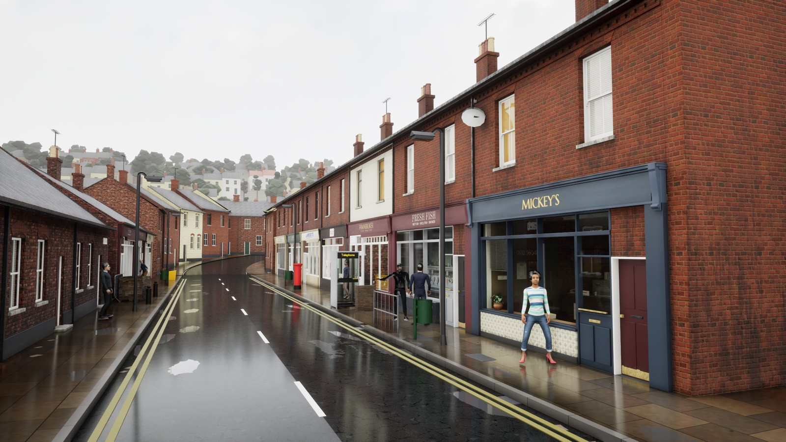
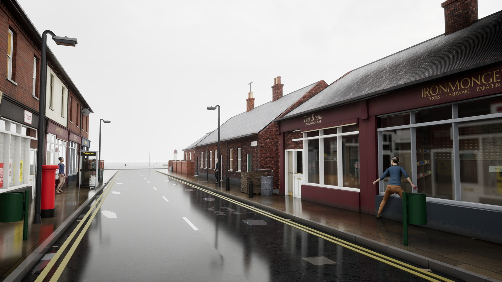
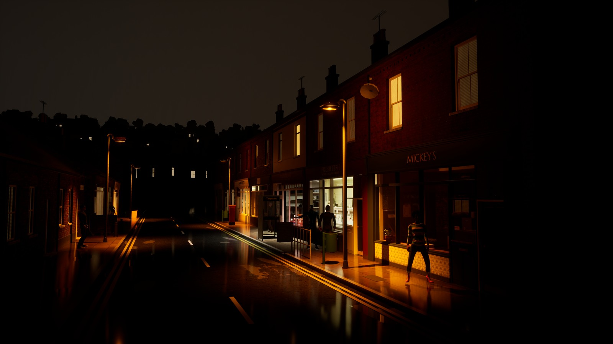
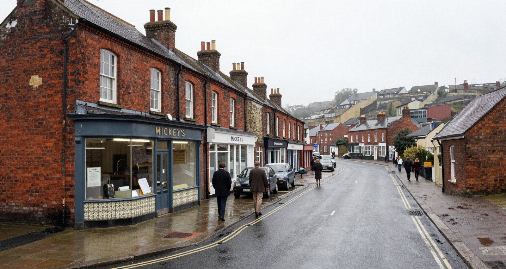

# For Jafar

The overview first; then the day's summary, under 200 words. Earlier summaries are in git and in
production/archive/FOR-JAFAR-to-2026-10-04.md (and FOR-JAFAR-to-2026-09-24.md before that).

## Overview (Thursday 22 October: your week's order, day two)

<!-- morning pictures: written by tools/morning_pictures.py -->

**Morning, Wednesday 21 October. Phase 1, prove the bottlenecks. On: 1.1 Mickey's front office, frontage, three views: production/research/pre-production/3-PROOFS.md. Next: 1.2 Tom and a speaker: production/casting/CASTING.md.**

| | Today, 21 Oct | Yesterday, 20 Oct |
|---|---|---|
| The hook camera by day |  | none |
| The reverse view |  | none |
| The street at night |  | none |

The Hook sheet, the bar they are held to: 

No decision asked: these are for watching the street change.

<!-- /morning pictures -->

**Your week's order, where it stands (22 October, 00:20; the 21 October overview is in git).**
- *1 to 4.* Done 21 October: health check, branches home, your rules and combat doc, the editor connection.
- *5, the cloud's pieces.* Lamp post C stands at the four lamp spots (darker, faint grime; its rain staining set aside). Rita's front, display and room are in the street as the shops' sample: four day views passed fresh reviewers; at night her window's light is too strong (set aside). **Your page: https://claude.ai/artifact/2yznAYjEwDVv3RvzzKUpBR** (Rita's front; the lamp done or not yet). The other families wait for your judgement, as you ruled.
- *6, frame rate.* Done: the packaged walk's worst frame 30.3 ms (it was 63), P1 closed by a fresh review (production/research/pre-production/P1-PACKAGED-2026-10-21.md).
- *7, the walk and the clothes.* Waits on Epic's samples from Fab (Needs you 3).
- *8, speech.* Pocket TTS on the processor timed (its first sound 0.13 s after the reply's first sentence; the game walks less smoothly while it works flat out) and the opener tried as an experiment; the Gemini test waits on your key (Needs you 4).
- *9, closing phase 1.* Waits on 7 and 8.

**Risks, Monday's review (production/research/pre-production/6-RISKS.md).**
- R3, the street missing the bar: up, 25. The audit finds the visual method unproved: five proof-view steps were set aside, and Mickey's room failed three reviews. Phase 1's binding stop answers it.
- R1, empty or unchecked talk: level, 25. The bench's 23 to 25 empty answers have not been re-run; in play, 0 of 8 were empty (P4).
- R2, slow replies: level, 25. 7 October, the real path: first sound 4.6 s median. 21 October: on the processor the voice's own share is 0.13 s; the model's time is what remains (the Gemini test waits on your key).
- R10 and R7, the friends' evening: down, 9 and 10. It runs on your account with its $5 cap and no second account. The Shipping launch and the limits surviving a restart are proved in 0.6.
- R9, the way of working: level, 12. Orders now come weekly and there is one session, but that holds only if shown.

### Needs you

1. Is "Help improve Claude" off in your claude.ai account? Your licence ruling of 3 October rests on it, and the Unreal editor connection now sends editor data. Recommended: check it once and say yes.
2. The command-line Claude needs you to sign in again (it expired while the PC was off), or the night jobs that ask Claude keep failing. Recommended: in the Terminal, type claude, sign in once, then type /exit.
3. Item 7 needs Epic's Game Animation Sample and the MetaHuman garments from Fab, which only your signed-in Epic launcher can fetch. Recommended: in the Epic Games Launcher, Fab library, create the Game Animation Sample project on F: and add the MetaHuman garments, then tell me.
4. Item 8's Gemini test waits on your key in the file F:\LedgerTools\keys\google.txt (still empty; never in chat). Recommended: paste it there when convenient; Pocket TTS goes ahead meanwhile.

### Road to worth playing (PLAN.md)

- **0. Recover control** (0.20W): done 6 October, passed by a fresh review with narrow points.
- **1. Prove the bottlenecks** (1.00W): Mickey's front office (passed 8 October), then a complete Tom and one speaker, the voice under two seconds, and P1 packaged (closed 21 October). If a sample fails within its ceiling, I report the failed capability.
- **2. Quay Street from proved families** (2.00W): the brick, the facades, the wet street's seam and the hill return here.
- **3. Thirty minutes that hold** (0.75W): N3 ported, the weather proof, P4's gaps.
- **4. The friends' candidate** (0.50W): on your own account, $5 an evening.
- **5. The first town:** after the pilot.
- **Friends:** eight to twelve weeks, if phase 1 passes; low confidence.

## Builder, Thursday 22 October (written 00:20, for your morning)

**Failed:** at night Rita's window light burns her display's whites and stains the pale goods red, and close up her shiny goods show blocky marks from the cloud's texture files: both set aside after two tries, named first on your page. The lamp's rain staining is set aside too. Pocket TTS, speaking flat out on the processor, makes the walk stall (43 and 92 ms frames).

**Done:** Rita's front passed the day views; your page has her window and the lamp column, every picture checked six times. Item 6: the walk's worst frame 30.3 ms (from 63), found by measuring three causes (the shop glass now baked, the hourly save written in the background, the card's visibility checks read two frames later); P1 closed by a fresh review. Item 8: Pocket's first sound 0.13 s; the opener experiment shows it clipped by a fast voice.

**Act on:** your page, two taps: https://claude.ai/artifact/2yznAYjEwDVv3RvzzKUpBR. Then Needs you 3 and 4 unblock items 7 and 8.
