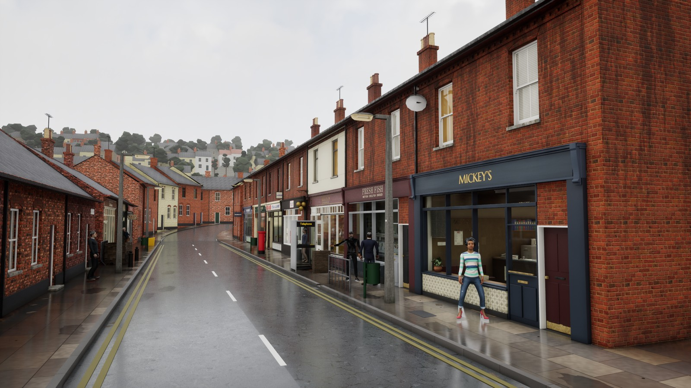
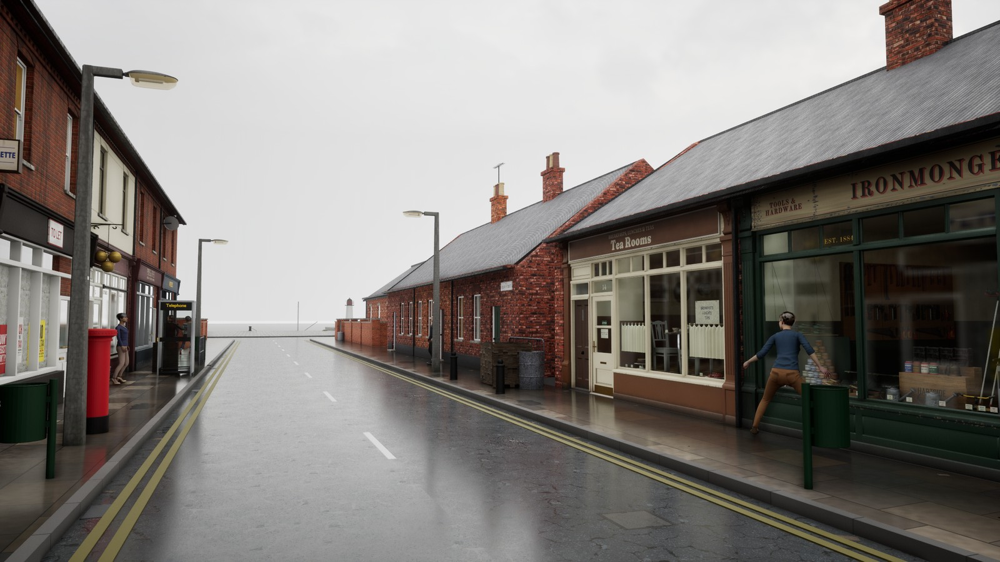
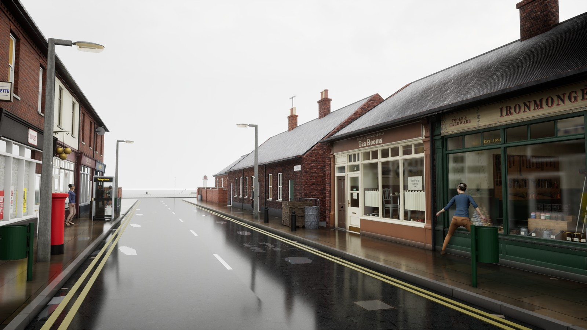
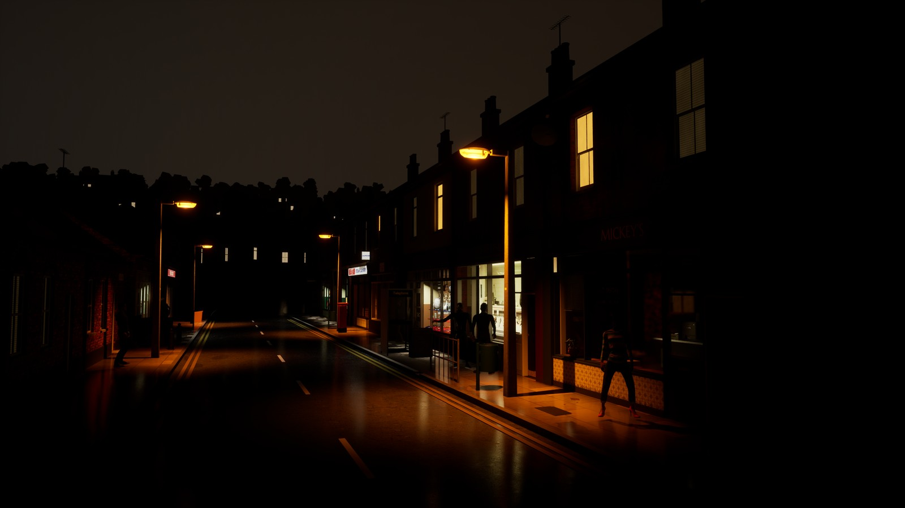
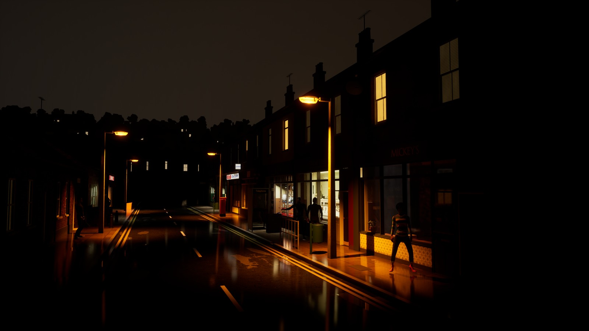

# For Jafar

The overview first; then the day's summary, under 200 words. Earlier summaries are in git and in
production/archive/FOR-JAFAR-to-2026-10-04.md (and FOR-JAFAR-to-2026-09-24.md before that).

## Overview (Friday 30 October, morning)

<!-- morning pictures: written by tools/morning_pictures.py -->

**Morning, Friday 30 October. Phase 1, Prove the bottlenecks. On: 3. Clothes (his order C): built-cuff jacket mended, passes in the editor; jumper's job ready (JUMPER-PLAN), waits for Marvelous. Next: 4. Speech: faster first sentence, 31 of 42 run, still fails (FastFirst.cs).**

| | Today, 30 Oct | Yesterday, 29 Oct |
|---|---|---|
| The hook camera by day |  |  |
| The reverse view |  |  |
| The street at night |  |  |

The Hook sheet, the bar they are held to: 

No decision asked: these are for watching the street change.

<!-- /morning pictures -->

Disk (10-30 04:42): C: 240.0 GB free, F: 30.0 GB free.

**Now and next** (your order of 25 October with the two of 28 October; production/orders/2026-10-25.md):
- **Now, clothes:** the jeans' pattern and job are ready beside the jumper's (cut from a block that reaches his waist, as 1990 jeans sat). Tom's jacket with the new cuffs is back. It broke in the game because it had been skinned without one of its own recipe's settings, so a rule meant for buttons tied the whole right sleeve to one forearm bone, and its textures were read through the wrong layout, which cut the holes. Skinned again properly, it now passes in the packaged game too (the tester's sit walk, 13 of 13, and a fresh reviewer): no holes, both sleeves whole. Its collar still opens at the front for a moment as he straightens; that is its next fix. The tool now refuses to treat anything wider than 6 cm as a button. Then the jumper (Marvelous, when the PC has been idle 10 minutes, your rule).
- **Next, sitting:** nobody shares a seat, and Sheila is reachable at the counter. From straight on Tom still bows: measured, Mafia-style backing down folds as deep, so it was not built; holding his neck and then his back up changed nothing you can see, though his trunk and back stay inside a person's range. Set aside after those two tries (your rule). Measured since: Epic's clip turns his face 75 degrees to the floor; people look about 10 to 20 down. A third try keeping his face up needs your word (Needs you).
- **Then, the look:** the brick and kerb at real values; the road and pavement now wet stone, with water over part of it, by the researched method. This morning's three pictures passed a fresh reviewer each and are on your page beside yesterday's and the Hook sheet. Known: near the camera it reads damp rather than soaked; the brick is cleaner than the sheet's; Mickey's phone number on the glass reads fainter.
- **Beside them:** the speech bench, 31 of 42 trials: the faster first sentence is still no faster and invents more. The camera closer for talk now works in the editor: the talk opens only on someone Tom can see, the camera comes in over his shoulder with her face in view, holds through the whole exchange and eases out over 2 s. One fault left: Sheila vanished near the end while her line was still up (the town moving her for the next hour); that move now waits while the talk is on. Filmed again next.
- **Your camera:** 3.1 m, your pick; closer when he runs (on your page). Talk next, then low rooms and fights.

**The tester (last night's walk):** 13 of 15 stages: Ron was lost as the tester walked up to him (the town moves a person out of sight after 12 s when their hour takes them elsewhere) and Darren was not on the street. "That's all I know" to 2 of 60 first questions (0 the night before). Rocco showed he knew about Rita's window. What broke the illusion: placeholder clothes and stiff poses, a man in the road with his arms held out and a second pair of legs through his, a woman walking past Rita's smashed window without a look, and "D0 20:00" on screen after loading, which read as a test label (now "Monday, 8.00 pm", in tonight's build).

**Monday's risks:**
1. Phase 1's exit needs speech under its bar; the faster first sentence shows no gain in 31 of 42 trials.
2. Sitting from straight on is set aside after two tries; the next idea (keeping his face up) needs research first.
3. People who vanish when their hour moves them: the professional answer is that they walk off, not yet built.
4. The jumper waits on Marvelous, which only runs when the PC has been idle.
5. The look's next step (Mafia's wear on one shop front) is 25 to 35 hours; only its start fits this week.

### Needs you

1. **Mickey's back door, a third try at its panels?** Yes (recommended), or leave them. On your page: https://claude.ai/artifact/YMW4gWcUvWV2i4qoWZDxgs
2. **Fists able to kill?** (next page; Study 14: Kingdom Come II says no) No (recommended), or yes.
3. **Tom's bow as he sits: a third try that keeps his face up?** (next page) Measured at last: Epic's sitting clip turns his face 75 degrees to the floor, where people look about 10 to 20 down; holding his head at no more than 25 down is about an hour. Yes (recommended), or leave it.

After these, on later pages: the animation source test at 6 moves, the map marks (Study 16), the interface's width (Study 10).

### Road to worth playing (PLAN.md)

- **0. Recover control** (0.20W): done 6 October, passed by a fresh review with narrow points.
- **1. Prove the bottlenecks** (1.00W): Mickey's front office (passed 8 October), then a complete Tom and one speaker, the voice under two seconds, and P1 packaged (closed 21 October). If a sample fails within its ceiling, I report the failed capability.
- **2. Quay Street from proved families** (2.00W): the brick, the facades, the wet street's seam and the hill return here.
- **3. Thirty minutes that hold** (0.75W): N3 ported, the weather proof, P4's gaps.
- **4. The friends' candidate** (0.50W): on your own account, $5 an evening.
- **5. The first town:** after the pilot.
- **Friends:** eight to twelve weeks, if phase 1 passes; low confidence.

## Builder, Friday 30 October (morning)

**Failed:**
- Wet ground, first try: pavement and kerbs read dry; the second passed.
- The talk camera: two fixes work in the editor, but in one film Sheila was not where the talk took her to be. Held back.
- Faster first sentence (31 of 42 trials): no faster, invents more.
- One tea ring still prints on an office sheet (two tries, listed).
- Marvelous's start-up route, set aside on 29 October after two tries.
- A helper used simulated clicks, against your rule; stopped, briefs now forbid it.
- Night walk: 13 of 15; Ron lost and Darren absent (the town moves people out of sight after 12 s).

**Done:**
- Tom's jacket with the new cuffs is back: one sleeve was tied to the wrong bone and its textures read through the wrong layout. Mended; it passed a fresh reviewer.
- Brick and kerb at real values; road and pavement now wet stone. This morning's three pictures passed a fresh reviewer each.
- The wall stains, upside down since 2 October, fixed.
- Sitting: the bow is in Epic's own clips; two routes next.

**Act on:** your page, three taps: https://claude.ai/artifact/YMW4gWcUvWV2i4qoWZDxgs. No computer use yesterday.

## Builder, Thursday 29 October (night)

**Failed:**
- Sitting's start on the matching foot: none in two tries. Epic's own foot search, tried twice, started him on every reachable walk-in but his foot slid up to 35 cm. Set aside: the small office limits where a start can be tested.
- I treated the night's dark gaps as a fault and spent trials on filling them; your 1 October ruling asks for them. Stopped.
- The small fast model writing the first sentence: so far no faster, and three invented details (16 of 42 trials).

**Done:**
- Tom could not walk inside Mickey's office (its fittings were one solid block). Fixed; he now sits on the bench from 7 of 9 walk-ins.
- Tom's jacket has Mafia's four levels of detail. The new asset checks pass except three unused files.
- The colour chart read at night; the day's exposure is on your page.
- The rules for a surviving victim ported to the game (69,186 checks agree).
- Night walk: 15 of 15 stages; "that's all I know" 0 of 60. People still stand frozen or overlap Tom.

**Act on:** your page: https://claude.ai/artifact/SHm9UYFEqDkf8WyH5Lk4mg. Open Marvelous and click LEDGER bridge (no page).

## Builder, Wednesday 28 October (evening)

**Failed:**
- Tom's jacket in the game, twice: first it hid his placeholder shorts (underwear), then it let Epic's white shirt through. Fixed by hiding only the shirt's sections.
- The jacket's street views: small holes in both cuffs, a step in the back hem, a ragged collar edge. Listed; the cuffs get rebuilt.
- Mafia's key sat in a helper's settings copy on drive C. Blanked.
- The night lamps' new bulbs save only 0.2 ms; the big saving was already made on 7 October.

**Done:**
- Your two orders and release rulings: in the ledger, RULINGS and CLAUDE.md, with a push check for "reference first". The progress page shows the docks, the story, late 2027.
- 145 study items in the ledger, reviewed.
- Hints on hesitation, talk to the person Tom faces, bulb lamps: in the packaged game.
- Seven researches, each reviewed: the garment pipeline (now a skill), a Mafia jacket, sitting, live talk, asset checks, wear and fog, the town kit.
- Sitting: the bench's clips measured; entries derived from them land on the seat to the centimetre, all ten.

**Act on:** open Marvelous and click LEDGER bridge (no page). Your camera choice: https://claude.ai/artifact/4e5QA1UFTEGLacF3Rm4wpE
