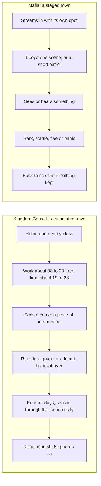

# Study 1: NPC life and AI (25 October 2026)

How Kingdom Come: Deliverance II (CryEngine) and Mafia: The Old Country (Unreal 5.4) make a town feel lived in, and how their people notice, remember and pass on what the player does. Read from the games' own data; the engines' code was not read, so formulas are known only through their constants. Our own words and numbers only. Raw counts are on F:/LedgerTools/aaa-study/kcd2/study-1/ and F:/LedgerTools/aaa-study/mafia/study-1/. All read 25 October 2026. Tags: **M** measured from the data, **R** read in a file or Warhorse's modding wiki, **I** inferred, **N** a class or asset name only.

**The short answer.** The two games sit at opposite ends. Kingdom Come II simulates a town: everyone has a home, a bed, a working day and a social class; crimes become pieces of information that witnesses carry to the authorities and friends, kept for days and spread through factions. Mafia stages a town: people loop one activity where they stand, react to what they see in the moment, and forget. LEDGER is already built the simulated way; Kingdom Come II's numbers are the useful ones.

## The two loops

## The numbers

| | Kingdom Come II | Mafia |
|---|---|---|
| Schedule | 64,529 places, 117,225 links (Kuttenberg's map; both maps 86,162 and 159,787); 3.4% of links timed | none |
| Activities | 1,123 behaviours | 389 looping scenes, 478 slots, no end and no cooldown |
| Usable objects in the town | 1,256 beds, 1,279 tables, 1,041 benches, 442 chests | 52 smart-object kinds |
| People | 1,354 in Kutná Hora (1,171 stock faces, 151 named, 32 animals) | 422 spawn definitions |
| Full detail | 70 within 150 m | simplify from 10 m; freeze unseen beyond 70 m after 3 s |
| Crime memory | 1 to 7 days by kind; spread daily through the faction | none |

## Daily life

- **Kingdom Come II's** scheduler links end in 1,123 behaviours (M). Only 3.4% of links carry a clock window (4,005; 299 windows, median 12 h); the rest are chosen by priority, stay time, role, class and weather (M). Weather filters 2,289 links (1,399 sun only, 890 rain only) (M).
  - Daily shape (M): the commonest windows are 08 to 20 (696 links) and 07 to 19 (640); about half the timed links (1,981) vary by ±30 min. A wake-up hour earlier for villagers is unverified.
  - About 2,600 to 2,760 timed links are live at midday against 340 to 450 between midnight and five, six to seven times more (M).
  - A traced day of one townswoman (M): a bed chosen by class (12 h); 08:00 to 09:00 wash at a tub, eat at the hearth, fetch wood, collect eggs; 19:00 to 23:00 a bench in sun, indoors in rain, or a tavern seat.
  - Kutná Hora: 53 households of median 4; 1,256 beds for about 1,320 humans, so nearly everyone sleeps indoors (M, I). The 726 fillers ("extras") come out through a door by day (hours unverified).
- **Mafia** has no schedule (M: no key for schedule, routine or hour in its AI, interaction, spawner or character data). Time of day is set per chapter.
  - People loop a scene: 389 scenes, 478 slots, none ending or cooling down (M); 374 scenes carry their own person, who appears when the scene streams in (M).
  - Walkers patrol a path with 60 s stops (R).

## Usable objects (benches, tables, doors)

- **Kingdom Come II:** a bench is two seats, each its own place in the scheduler with a "use" link and a player action (R). Its 16 named streets hold a median of 1,286 scheduler places each (436 to 2,995) (M); usable objects per street were not counted.
  - Claiming (M, R): 2,254 links cap their users (1,694 at one), 829 can push the current user off, 5,995 cannot follow themselves. A person searches only when it finishes what it is doing (R).
- **Mafia:** Epic's Smart Objects with up to three slots; 52 definitions, 290 objects for one, 22 for two (including side-by-side and angled), 11 for three (M). Claim and leave logic is in names only.

## Crowds and detail

- **Kingdom Come II:** full detail for 70 people within 150 m (80 within 180 to 220 m at the top levels; 300 lighter ones on the smallest console) (R). People's update budget 3.5 (2.5 in performance modes; unit unverified) (R). The dead are replaced after 7 days (3 for public enemies); undiscovered bodies vanish after an hour (R).
- **Mafia:** three tiers (M): civilians (full AI), puppets (scripted, no controller) and set-piece crowds (shared animation, no collision, no AI; 14 set-ups for parades and races). Civilians simplify from 10 m and pause their look-at beyond 32 m; they freeze unseen beyond 70 m after 3 s, never within 10 m; they are removed 5 m out of view or with their streamed cell (R).
- **People on screen by day or night:** set in neither game's data; Kingdom Come II's hourly curve of timed links is the nearest stand-in.

## Noticing, compared like with like

| | Kingdom Come II | Mafia | LEDGER |
|---|---|---|---|
| Field of view | 90 to 100°, plus 1° per hearing point (R) | civilians 80° (40° each side) (M) | 120°, the outer 60° sees only movement |
| Range | 2.5 to 50 m by the watcher's vision; inside 2.5 m, at once (R) | civilians 25 m, hearing 50 m (M) | 40 m; a face at 8 m, recognised at 25 m |
| First noticing | at once within 2.5 m (R) | a guard investigates in about 0.15 s and turns hostile in 0.30 s at 3 m, 0.51 s at 10 m, 3.6 s at 19.5 m, against a walking player; never from behind (I, reproduced from its curves) | a glance becomes a look in 0.35 s (0.7 s if the player stands still, 1.0 s at the edge of view) |
| Recognising | about 4 s at neutral conspicuousness, 2 s high, 8 s low (I, combined from constants) | none | 1.2 s to identify |
| Movement and light | night outdoors −0.7, indoors −0.5, fog −0.5, tall grass −0.35 (R) | facing ×1.6 ahead, ×0.1 to the side-back, 0 behind; running heard, walking not (R) | running ×2, still ×0.5; light and distance rungs; a hearing model |
| What gives you away | dirt over 0.9, blood, health under 30, smell, a drawn weapon, no torch at night; class read from clothes (R) | trespass zones ×10 (R) | |

## Witnesses, memory and talk

- **Kingdom Come II's crimes are pieces of information** (R):
  - 30 kinds, 22 crimes, 9 violent, 25 can spread. Fines and jail by kind: murder 20,000 and 7 days, assault 1,500 and 5, theft 500 and 3, trespass 250 and 1; for 7 kinds the fine rises with social class (whose class is not stated).
  - A witness chooses among the game's interruptions (about 43 kinds in all, among them look, check, watch, flee, attack, arrest, warn, report, return with help); violent crimes and murder raise the priority (R).
  - Reports go to an authority, a guard or a friend; the witness runs there and hands over the information (R). It carries 10 m (40 m long-range); alarms 25 m; reports within 15 m and up to 150 m (500 m for important ones); 5 to 10 watchers at most; the fleeing keep 30 m away for 7 min (R).
  - It is kept for days (a day times the crime's expiry of 1 to 7) and re-broadcast through the faction tree once a day when the player is more than 30 m away (R).
  - Reputation is a weighted median of person, faction and wider faction (5:3:1); it reaches the faction after about 3 h; nearby factions within 400 m take a quarter (R). Examples (to the person / when reported): murder −0.6 / −1.5, theft −0.25 / −0.15, assault −0.3 / −0.3.
  - Idle "gossip" is chatter only and carries no crime information (R).
- **Mafia keeps nothing** (M, N): no wanted level, no heat, no gossip. Reactions are a rule engine choosing bark, startle, stop, look, flee or panic; civilians have three states (patrol, patrol without panic, panic). Talk about the player is limited to the moment (a found body, trespass). The police are factions; 9 arrest voice lines were found.

## Principals and crowd

- **Kingdom Come II:** 151 named people against 1,171 stock faces (M). A filler has a home link with routine priorities 0 to 5; a named person can carry up to 144 links, with story behaviours at priorities 45 to 200 (M). 6,038 rules choose dress, voice, abilities and names, by name for principals and by class, voice and faction for the crowd (R).
- **Mafia:** of 176 named definitions, 78 use the civilians' own controller and state tree, 46 the companion's, and 77 have reactions turned off for their scenes (M).

## What LEDGER already does, and how it differs

- Named residents keep hour-by-hour routines (CastDay). Talk passes only where routines meet, within six metres; confidence falls each hop; each person knows who told them; rumours fade on a 96-hour half-life, a body never (Gossip). Kingdom Come II also passes crime information to friends and through factions, but by broadcast: it has no who-told-whom, no falling confidence and no need to meet.
- Witnesses walk to report, can be stopped on the way, and what they report becomes permanent only on arrival (Witnesses, the delivery window). The law can be pointed at others (Informing).
- Perception has a wider cone than either game (its outer part sees only movement). Its range is shorter than Kingdom Come II's longest (40 m against 50 m), and up close it is not faster than Mafia's guards.

## What to adopt

1. **Crime expiry by kind** (1 to 7 days, from Kingdom Come II's table) in place of the single 96-hour half-life, the body staying as it is. The spread stays by routine meetings: Kingdom Come II's daily faction broadcast would break canon ("gossip spreads through schedule intersections"), so it is not adopted.
2. **Make the witness's walk visible in the game:** the simulation already does it; the item is seeing a witness go to someone and hand it over, in the Unreal game.
3. **Benches, tables, doors and beds as places in the routine,** each seat its own slot with a cap and an owner: Tom's bench (item 2, this week) uses the first seats file; residents next, through the same file.
4. **For the crowd, not the named:** a few clock windows and priority for the rest (Kingdom Come II times 3.4% of links); the hours from LEDGER's own research on a 1990 British town, not a medieval one. Named residents are already fully timed in CastDay.
5. **What gives you away:** dirt, blood, a drawn weapon, the wrong clothes for your class; running already counts in LEDGER.
6. **Detail by distance:** full detail for the nearest, freeze the unseen beyond 70 m (Study 12).

## Coverage map

Ticked: NPC life, schedules, smart objects, crowds, perception, witnesses and reputation (data side, both games). Open: the engines' scoring and perception formulas (compiled code).

## Open blind spots

- Both engines' code: scheduler scoring, the perception formula, units of time in the script settings.
- Mafia's reaction rules, bark table, faction attitudes and cooldowns (compiled or not exported).
- People on screen per street by hour; usable objects per street; reactions to the player (greetings, stepping aside) and to noise; Mafia and weather.
- Only about 12 of Kingdom Come II's 308 crime behaviour trees were read, as outlines.
- Wiki defaults may differ from the shipped data.

## Sources

- Kingdom Come II: scheduler.xml, objects_mission0.xml, the Libs tables (crimes, reputation, factions, souls), the AI scripts, Engine.pak settings; Warhorse's modding wiki articles KM-A-93 (scheduler links), KM-A-27 (crime) and KM-A-20 (RPG constants), read 25 October 2026; F:/LedgerTools/aaa-study/kcd2/study-1/.
- Mafia: AI, world-interaction, spawner and character data; perception configs; the name index of all packages; F:/LedgerTools/aaa-study/mafia/study-1/.
- LEDGER: ledger/Assets/Scripts/Core (Perception, Gossip, CastDay, Informing) and Game/Witnesses.

## Review

A fresh reviewer (25 October, evening) checked the numbers against the data, the three wiki articles and LEDGER's code: pass with fixes. Corrected here: five small Mafia counts; the noticing comparison rebuilt like with like; the arrest count; the daily shape tagged as measured; the scheduler's figures named as one map's; "one-time" and the reactions read rightly; LEDGER's section rewritten (rumour ageing, the witness's walk, the true difference); adopt items 1, 2 and 4 rewritten to keep canon's rule on how gossip travels; a numbers table added.

Cost, from the clock: the Kingdom Come helper earlier on 25 October, the Mafia helper to about 21:40, this synthesis to 21:50, the review to about 21:58, its fixes to 22:04.
